<!-- _class: lead -->

<style scoped>
.logo-bar { position: absolute; top: 36px; right: 64px; display: flex; align-items: center; gap: 16px; }
.logo-bar img { width: 100px; height: 100px; object-fit: contain; }
</style>

<div class="logo-bar">
  
</div>

# Mini AI Agent Engineering

<div class="subtitle">Module 1 — พื้นฐาน AI, Automation และ Agent Engineering</div>

**หลักสูตร** Mini AI Agent Engineering — ออกแบบ สร้าง ทดสอบ และนำ AI Agent ไปใช้งานด้วย n8n

ผศ. ดร.ทวีศักดิ์ สมานชื่น
CBTU · คณะวิศวกรรมศาสตร์ · มหาวิทยาลัยมหิดล

---

## วัตถุประสงค์การเรียนรู้

เมื่อจบ module นี้ ผู้เรียนสามารถ:

1. **อธิบาย** บทบาทของ AI, Automation และ AI Agent ในการแก้ปัญหางานจริง
2. **เข้าใจ** ประโยชน์และความสำคัญของ Workflow Automation
3. **ระบุ** Use Cases ที่เหมาะกับ Workflow และ AI Agent
4. **ประเมิน** ความพร้อมขององค์กรในการนำ Automation มาใช้
5. **วางแผน** แนวทางพัฒนา AI Agent ตั้งแต่ต้นแบบจนถึงการใช้งานจริง

---

## เนื้อหาใน Module นี้

1. **AI & Automation ในยุคปัจจุบัน** — ภาพรวมและแนวโน้ม
2. **Workflow Automation คืออะไร?** — นิยามและหลักการ
3. **โจทย์จากงานจริง** — ปัญหาและโอกาสในการทำ Automation
4. **Use Cases** — ตัวอย่างการใช้งานจริง
5. **Tools Ecosystem** — เครื่องมือที่ใช้งานได้
6. **n8n Overview** — ทำไมต้อง n8n?

---

<!-- _class: divider -->

## 01
## AI & Automation ในยุคปัจจุบัน

The Rise of AI-Powered Automation

---

## ปัญหาการทำงาน

<div class="columns">
<div>

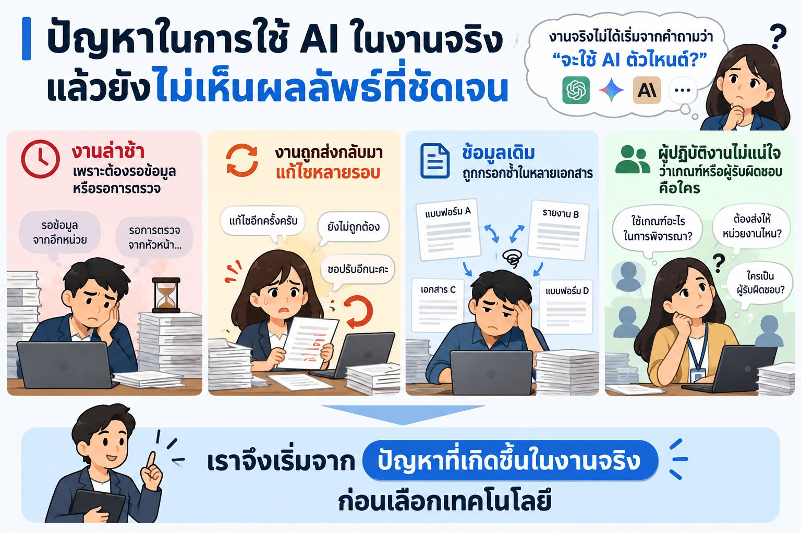

</div>
<div>

> ปัญหาในการทำงานมีหลากหลาย
> ต้องพิจารณาปัญหาอย่างรอบคอบ
> แล้วจึงเลือกใช้ทางแก้ที่เหมาะสม

แม้จะใช้ AI แล้วแต่เราก็จะสามารถพบว่า
ยังมีปัญหาเดิมๆ อยู่หากเราแก้ปัญหาไม่ตรงจุด

</div>
</div>

---

## แนวทางการทำงานในปัจจุบัน


- **Manual Process** — มนุษย์ทำงานทุกขั้นตอนด้วยตนเอง
- **AI-Assitance** - เช่นการใช้ chatbot ช่วยในการทำาน 
- **Automation** — ระบบทำงานซ้ำ ๆ แทนมนุษย์โดยอัตโนมัติ
- **AI-Powered Automation** — ระบบตัดสินใจและปรับตัวได้ด้วย AI

---
<div class="center">

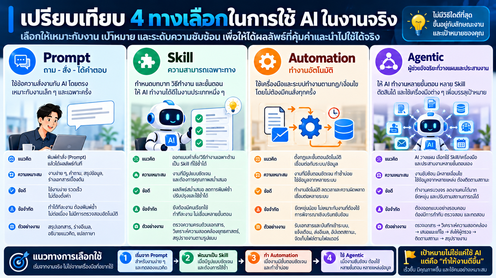

</div>

---

## แนวโน้มระดับโลก 


### Digital Transformation ในองค์กร

- 🌐 **Open Data & APIs** — เชื่อมต่อข้อมูลและบริการ
- 📊 **Data-Driven Decisions** — ตัดสินใจบนข้อมูลที่ตรวจสอบได้
- 🤖 **AI in the Workplace** — ประยุกต์ AI กับงานความรู้และบริการ
- ⚡ **Real-time Analytics** — วิเคราะห์ข้อมูลแบบ Real-time

### AI Engineering Today

- จาก Prompt ทดลอง สู่ระบบที่เชื่อมต่อ Workflow และ Tools
- ให้ความสำคัญกับความถูกต้อง ความปลอดภัย และการประเมินผล

---

<!-- _class: divider -->

## 02
## Workflow Automation คืออะไร?

What is Workflow Automation?

---

## นิยามและหลักการ

### Workflow Automation

**Workflow** = ลำดับขั้นตอนการทำงานที่เชื่อมต่อกัน
**Automation** = การให้ระบบทำงานเหล่านั้นโดยอัตโนมัติ

### ส่วนประกอบหลัก

| ส่วนประกอบ | ความหมาย | ตัวอย่าง |
|---|---|---|
| **Trigger** | สิ่งที่เริ่มต้น Workflow | เวลา, เหตุการณ์, ข้อมูลใหม่ |
| **Action** | งานที่ระบบทำ | ดึงข้อมูล, แปลง, ส่งรายงาน |
| **Integration** | การเชื่อมต่อระบบ | API, Database, Email |

---

## ประโยชน์ของ Workflow Automation

### สำหรับทีมและกระบวนการทำงาน

- ⏱️ **ประหยัดเวลา** — ลดงาน Manual ที่ทำซ้ำๆ ได้ถึง 80%
- 🎯 **ลด Human Error** — ข้อมูลถูกต้องและสม่ำเสมอมากขึ้น
- 📈 **Scalability** — รองรับข้อมูลปริมาณมากโดยไม่ต้องเพิ่มคน
- 🔄 **Real-time** — ประมวลผลและรายงานได้ทันที
- 💡 **ทรัพยากรมีคุณค่ามากขึ้น** — เจ้าหน้าที่โฟกัสงานที่มีคุณค่าสูง

---

<!-- _class: divider -->

## 03
## ปัญหาในงานประจำ

ปัญหาและความท้าทายในปัจจุบัน

---

## ปัญหาที่พบบ่อยในกระบวนการทำงาน

### กระบวนการที่ต้องปรับปรุง

- 📋 **รับคำขอด้วยมือ** — คัดลอกข้อมูลจากหลายช่องทาง
- 🗂️ **ความรู้กระจัดกระจาย** — อยู่ในเอกสาร FAQ และระบบต่างๆ
- ⏰ **ตอบกลับล่าช้า** — ทีมงานต้องค้นข้อมูลซ้ำ
- 🔁 **ทำงานซ้ำทุกวัน** — คำถามและขั้นตอนเดิมเกิดขึ้นบ่อย
- ❌ **ข้อมูลผิดพลาด** — Human Error จากการทำงานด้วยมือ

---

## กระบวนการทำงานที่พบบ่อย

### Before Automation

```
1. รับคำขอ → 2. ค้นเอกสารและระบบหลายแห่ง (ด้วยมือ)
→ 3. รวมข้อมูล → 4. ตรวจสอบความถูกต้อง
→ 5. เขียนคำตอบหรือสรุป → 6. ส่งกลับผู้ขอ
→ (ทำซ้ำทุกวัน / ทุกสัปดาห์)
```

### After Automation

```
รับคำขอ → Workflow ตรวจสอบและค้นข้อมูล
→ AI Agent สรุปพร้อมแหล่งอ้างอิง → ส่งให้ผู้ใช้ตรวจทาน
(มี Monitoring และ Human review ตามความเสี่ยง)
```

---

<!-- _class: divider -->

## 04
## Use Cases

ตัวอย่างการใช้ Workflow Automation ในงานจริง

---

## Use Case 1: สรุปผลการดำเนินงานอัตโนมัติ

### Monthly Operations Report

**ปัญหา:** ทีมใช้เวลาหลายชั่วโมงต่อเดือนรวบรวมตัวเลขจากหลายระบบ

**วิธีแก้ด้วย Automation:**
1. **Trigger:** ทุกวันที่ 1 ของเดือน เวลา 08:00
2. **Action 1:** ดึงข้อมูลยอดขายและ ticket จาก API
3. **Action 2:** ตรวจสอบคุณภาพและสรุปตัวชี้วัด
4. **Action 3:** สร้างรายงานและส่งให้ทีม


**ผล:** ลดงานรวบรวมข้อมูลและทำให้ทีมเห็นประเด็นสำคัญเร็วขึ้น

---

## Use Case 2: แจ้งเตือนเหตุผิดปกติ

### Operations Anomaly Alert

**ปัญหา:** จำนวนคำขอหรือข้อผิดพลาดเพิ่มขึ้น แต่ทีมสังเกตเห็นช้า

**วิธีแก้ด้วย Automation:**
1. **Trigger:** มี event หรือข้อมูลใหม่เข้าระบบ
2. **Action 1:** ตรวจสอบรูปแบบและค่าที่จำเป็น
3. **Action 2:** เปรียบเทียบกับเกณฑ์หรือช่วงเวลาที่ผ่านมา
4. **Action 3:** หากพบความผิดปกติ → แจ้งเตือนทีมทาง LINE/Email

**ผล:** ตรวจพบและส่งต่อปัญหาได้รวดเร็วยิ่งขึ้น

---

## Use Case 3: รวมข้อมูลเพื่อช่วยทีมตัดสินใจ

### Data Integration Pipeline

**แหล่งข้อมูลที่พบในองค์กรทั่วไป:**

| แหล่งข้อมูล | ประเภท | ความถี่ |
|---|---|---|
| ระบบ CRM / Support | REST API | Real-time |
| ฐานข้อมูลภายใน | SQL Database | Real-time |
| ไฟล์ Excel/CSV | File Upload | รายวัน/เดือน |
| คู่มือและเอกสาร | PDF / Knowledge Base | เมื่อมีการปรับปรุง |
| แบบฟอร์มออนไลน์ | Form API | ต่อเนื่อง |

---
## Use Case 4: VIMS 

- เป็นระบบรวมข้อมูล Vaccine 
- ข้อมูลมีการกระจัดกระจาย
- ใช้คนทำงานรวบรวมเสียเวลาและความถูกต้อง
- ปรับเป็นระบบ ETL + AI 

https://vims-production-5856.up.railway.app

---
<div class="center">


</div>

---
<!-- _class: divider -->

## 05
## Tools Ecosystem

เครื่องมือ Workflow Automation ที่ใช้งานได้

---

## ภาพรวม No-Code / Low-Code Automation Tools

### เปรียบเทียบเครื่องมือยอดนิยม

| Tool | ประเภท | จุดเด่น | เหมาะกับ |
|---|---|---|---|
| **n8n** | Open Source | Self-hosted, Flexible | Developer / IT |
| **Zapier** | Cloud SaaS | ง่าย, เร็ว | Business Users |
| **Make (Integromat)** | Cloud SaaS | Visual, Powerful | Mid-level |
| **Power Automate** | Microsoft | Microsoft 365 | องค์กรที่ใช้ MS |
| **Apache Airflow** | Open Source | Data Pipeline | Data Engineer |
| **Prefect**  | Open Source | Data Pipeline | Data Engineer |
---

## ทำไมต้อง n8n?

### ข้อดีของ n8n สำหรับการสร้างระบบ

- 🔓 **Open Source & Free** — ไม่มีค่าใช้จ่าย License
- 🏛️ **Self-hosted** — เลือกแนวทางติดตั้งให้เหมาะกับข้อกำหนดข้อมูล
- 🔒 **Data Privacy** — ควบคุมการไหลของข้อมูลได้
- 🔌 **400+ Integrations** — เชื่อมต่อได้กับระบบมากมาย
- 💻 **Visual Interface** — สร้าง Workflow ด้วย Drag & Drop
- 🤖 **AI Integration** — รองรับ AI/LLM nodes

---

<!-- _class: divider -->

## 06
## เริ่มต้น Automation

แนวทางการนำ Workflow Automation มาใช้ในองค์กร

---

## Framework การเริ่มต้น Automation

### 3 ขั้นตอนสู่ Automation

**ขั้นที่ 1: Identify**
- รวบรวมงาน Manual ที่ทำซ้ำๆ
- ประเมินเวลาและความถี่

**ขั้นที่ 2: Design**
- วาง Workflow ที่ต้องการ
- กำหนด Trigger, Action, Output


---
## Framework การเริ่มต้น Automation (ต่อ)


**ขั้นที่ 3: Implement & Monitor**
- สร้าง Workflow ด้วย n8n
- ทดสอบและปรับปรุง

---

## Automation Readiness Checklist

### ประเมินความพร้อมของทีม

- [ ] มีงาน Manual ที่ทำซ้ำๆ อย่างสม่ำเสมอ
- [ ] ข้อมูลมีโครงสร้างที่ชัดเจน (มี API หรือ Database)
- [ ] มีเจ้าหน้าที่ IT สนับสนุน
- [ ] มี Server หรือ Cloud สำหรับ Deploy n8n
- [ ] มีผู้รับผิดชอบและเกณฑ์วัดผลชัดเจน

> **เริ่มเล็กก็ได้** — เลือก Use Case ง่ายๆ 1 อย่างแล้วทดลองทำก่อน

---

<!-- _class: divider -->

## 07
## สรุปและบทเรียนถัดไป

Summary & What's Next

---

## สรุป Module 1

### สิ่งที่เรียนรู้ใน Module นี้

- ✅ **AI & Automation** ช่วยแก้ปัญหางานซ้ำอย่างไร
- ✅ **Workflow Automation** ช่วยลดงาน Manual และ Human Error
- ✅ **Use Cases** ที่เหมาะกับ Workflow และ AI Agent
- ✅ **Use Cases** หลากหลายที่ประยุกต์ใช้ได้จริง
- ✅ **n8n** เป็นเครื่องมือสร้างและเชื่อมต่อ Workflow

### Module ถัดไป

**Module 2:** Introduction to n8n — Interface, Nodes และการตั้งค่าเบื้องต้น

---

<!-- _class: lead -->

# พร้อมแล้วสำหรับ n8n!

**Module 2:** Introduction to n8n

มาเรียนรู้เครื่องมือที่จะเปลี่ยนวิธีทำงานของคุณ

---

<!-- footer: "Mini AI Agent Engineering | Module 2 — n8n Fundamentals" -->


<!-- _class: lead -->

<style scoped>
.logo-bar { position: absolute; top: 36px; right: 64px; display: flex; align-items: center; gap: 16px; }
.logo-bar img { width: 100px; height: 100px; object-fit: contain; }
</style>

<div class="logo-bar">
  
</div>

# Introduction to n8n

<div class="subtitle">Module 2 — n8n: เครื่องมือสร้าง Workflow สำหรับ AI Agent</div>

**หลักสูตร** Mini AI Agent Engineering

ผศ. ดร.ทวีศักดิ์ สมานชื่น
CBTU · คณะวิศวกรรมศาสตร์ · มหาวิทยาลัยมหิดล

---

## วัตถุประสงค์การเรียนรู้

เมื่อจบ module นี้ ผู้เรียนสามารถ:

1. **อธิบาย** สถาปัตยกรรมและหลักการทำงานของ n8n
2. **ระบุ** ส่วนประกอบหลักและ Node Types ต่างๆ
3. **ใช้งาน** Interface ของ n8n ได้อย่างคล่องแคล่ว
4. **ตั้งค่า** Credentials เพื่อเชื่อมต่อกับบริการภายนอก
5. **สร้าง** Workflow เบื้องต้นอย่างง่ายได้

---

## เนื้อหาใน Module นี้

1. **n8n คืออะไร?** — ประวัติ, ลักษณะ, ความสามารถ
2. **สถาปัตยกรรม n8n** — Self-hosted vs Cloud
3. **Interface ของ n8n** — ทำความคุ้นเคยกับ UI
4. **Node Types** — ประเภทของ Nodes ต่างๆ
5. **Credentials & Connections** — การเชื่อมต่อบริการภายนอก
6. **Data Flow** — ข้อมูลไหลอย่างไรใน n8n

---

<!-- _class: divider -->

<style scoped>
.n8n-logo { position: absolute; right: 100px; top: 50%; transform: translateY(-50%); width: 520px; object-fit: contain; }
</style>

## 01
## n8n คืออะไร?

What is n8n?


---

## รู้จัก n8n

### n8n — Workflow Automation Platform

- **ชื่อ:** n8n (อ่านว่า "n eight n")
- **ปีที่เริ่มต้น:** 2019 โดย Jan Oberhauser
- **License:** Fair-code (Source Available)
- **GitHub:** github.com/n8n-io/n8n
- **Integrations:** 400+ บริการและ API

### คำขวัญ
> "Build complex automations 10x faster, without fighting APIs"

---

## ความสามารถหลักของ n8n

### Core Features

| ความสามารถ | รายละเอียด |
|---|---|
| **Visual Workflow Builder** | Drag & Drop ไม่ต้องเขียนโค้ด |
| **Code Node** | เขียน JavaScript/Python ได้เมื่อต้องการ |
| **Trigger Nodes** | Webhook, Schedule, Event-based |
| **400+ Integrations** | APIs, Databases, Apps |
| **AI Nodes** | LangChain, OpenAI, Ollama |
| **Self-hosted** | ควบคุมข้อมูลได้ 100% |

---

## n8n เทียบกับเครื่องมืออื่น

### ข้อดีที่โดดเด่น

```
Zapier          → ง่าย แต่แพง และข้อมูลผ่าน Cloud
Make            → ดี แต่ค่าใช้จ่ายตาม Operation
Power Automate  → ดีสำหรับ Microsoft แต่ Lock-in
─────────────────────────────────────────────
n8n             → Open Source + Self-hosted
                  ข้อมูลอยู่ในองค์กร
                  ไม่มีค่าใช้จ่าย License
                  ยืดหยุ่นสูง + Custom Code
```

---

<!-- _class: divider -->

## 02
## สถาปัตยกรรม n8n

n8n Architecture & Deployment

---

## วิธีติดตั้ง n8n

### ตัวเลือกการ Deploy

<div class="columns">
<div>

**Option 1: Docker (เหมาะกับการพัฒนาซ้ำและ Deploy อย่างควบคุมได้)**
```bash
docker run -it --rm \
  --name n8n \
  -p 5678:5678 \
  -v ~/.n8n:/home/node/.n8n \
  n8nio/n8n
```

</div>
<div>

**Option 2: npm**
```bash
npm install n8n -g
n8n start
```

**Option 3: n8n Cloud** (เหมาะกับการเรียน)
n8n.io (ต้องการ Subscription)

</div>
</div>

---

## สถาปัตยกรรมภายใน

<div class="center">

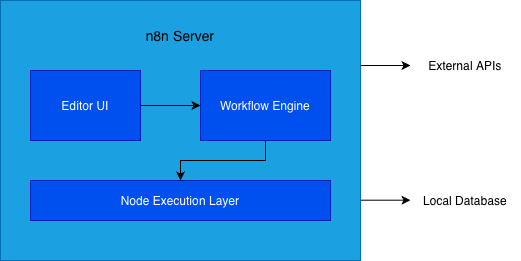

</div>

---

<!-- _class: divider -->

## 03
## Interface ของ n8n

Getting Familiar with n8n UI

---

<div class="center">

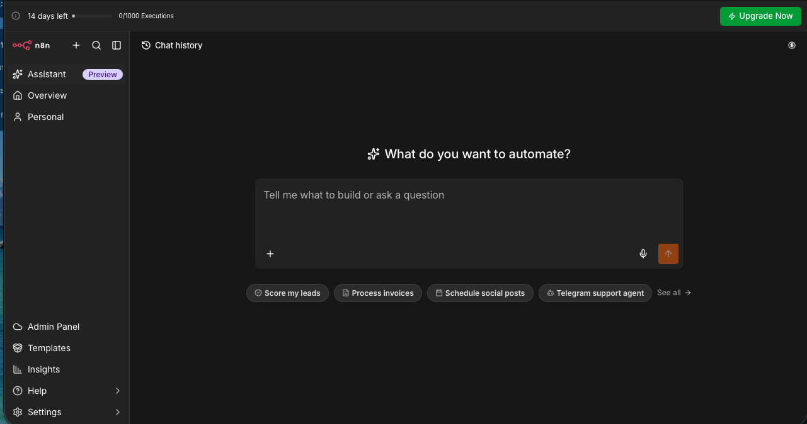

</div>

---

<div class="center">

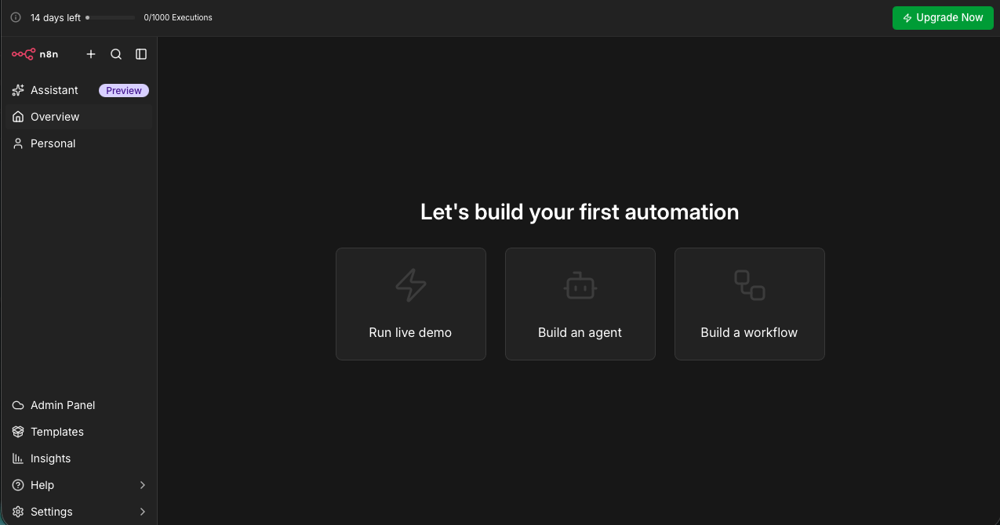

</div>

---

<div class="center">

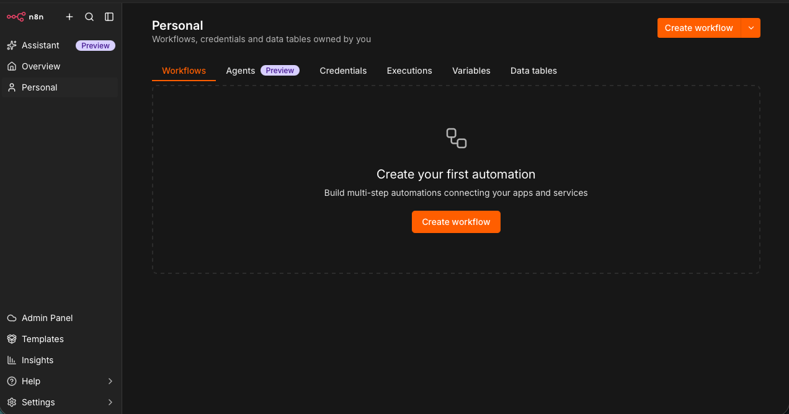

</div>

---

<div class="center">

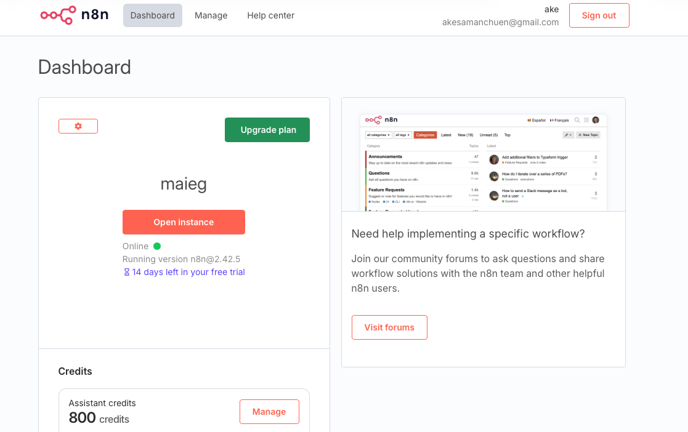

</div>

---

<div class="center">

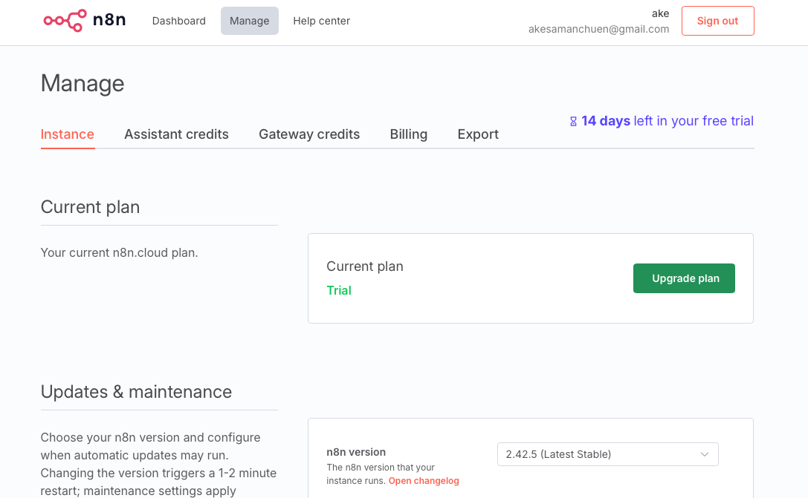

</div>

---
## ส่วนประกอบหลักของ UI
<div class="columns">
<div>

### หน้า Dashboard หลัก

- 📋 **Workflows** — รายการ Workflow ทั้งหมด
- 🔑 **Credentials** — จัดการการเชื่อมต่อ API/Service
- ⚙️ **Settings** — ตั้งค่าระบบ
- 📊 **Executions** — ประวัติการรัน Workflow
</div>
<div>

### Editor Canvas

- **Node Panel** — รายการ Nodes ทั้งหมด (ด้านซ้าย)
- **Canvas** — พื้นที่วาง Workflow (ตรงกลาง)
- **Node Settings** — ตั้งค่า Node ที่เลือก (ด้านขวา)
- **Execution Log** — ผลการรัน (ด้านล่าง)
</div>
</div>

---

## การใช้ Canvas

### Keyboard Shortcuts ที่ใช้บ่อย

| คำสั่ง | Shortcut |
|---|---|
| เพิ่ม Node ใหม่ | `Tab` หรือ คลิก `+` |
| บันทึก Workflow | `Ctrl/Cmd + S` |
| รัน Workflow | `Ctrl/Cmd + Enter` |
| Zoom In/Out | `Ctrl/Cmd + Scroll` |
| Select All | `Ctrl/Cmd + A` |
| ลบ Node | `Delete` / `Backspace` |
| Duplicate Node | `Ctrl/Cmd + D` |

---

<!-- _class: divider -->

## 04
## Node Types

ประเภท Nodes ใน n8n

---

## Trigger Node

### Trigger Nodes — จุดเริ่มต้นของ Workflow

| Node | การทำงาน |
|---|---|
| **Schedule Trigger** | รันตามเวลาที่กำหนด (cron) |
| **Webhook** | รับ HTTP Request จากภายนอก |
| **Manual Trigger** | รันด้วยตนเอง (สำหรับทดสอบ) |
| **Email Trigger (IMAP)** | ทำงานเมื่อได้รับอีเมล |
| **File Trigger** | ทำงานเมื่อมีไฟล์ใหม่ |

---

## Action Nodes ที่ใช้บ่อย

### สำหรับงานข้อมูลและการทำงานซ้ำ

| Node | การใช้งาน |
|---|---|
| **HTTP Request** | เรียก REST API ต่างๆ |
| **Code** | เขียน JavaScript / Python |
| **Set** | กำหนดค่าตัวแปร |
| **IF / Switch** | เงื่อนไขการทำงาน |
| **Merge / Split** | รวมหรือแยกข้อมูล |
| **Spreadsheet File** | อ่าน/เขียน Excel/CSV |
| **Send Email** | ส่งอีเมลรายงาน |
| **Postgres / MySQL** | เชื่อมต่อฐานข้อมูล |

---

## Data Transformation Nodes

<div class="center">

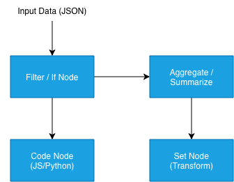

</div>


---

<!-- _class: divider -->

## 05
## Credentials & Connections

การตั้งค่าการเชื่อมต่อบริการภายนอก

---

## Credentials คืออะไร?

### การจัดการ API Keys และ Authentication

- **Credentials** = ข้อมูลการยืนยันตัวตนสำหรับบริการภายนอก
- n8n เข้ารหัส Credentials ด้วย AES-256
- สร้างครั้งเดียว ใช้ได้กับ Workflow ทุกอัน

---

## Credentials คืออะไร? (ต่อ)
### ประเภท Authentication ที่รองรับ

| ประเภท | ตัวอย่าง |
|---|---|
| **API Key** | Most REST APIs |
| **OAuth2** | Google, Microsoft |
| **Basic Auth** | Username + Password |
| **Bearer Token** | JWT APIs |
| **Custom Header** | Custom APIs |

---

## การตั้งค่า Credentials

### ขั้นตอนการเพิ่ม Credential

1. ไปที่ **Settings → Credentials → Add Credential**
2. ค้นหาบริการที่ต้องการ (เช่น HTTP Request, Gmail)
3. กรอกข้อมูล API Key หรือ OAuth
4. กด **Save & Test** เพื่อทดสอบ
5. ใช้ Credential นี้ใน Workflow ได้ทันที

> **ข้อควรระวัง:** อย่าเก็บ API Key ไว้ใน Node Parameters โดยตรง ใช้ Credentials เสมอ

---

<!-- _class: divider -->

## 06
## Data Flow ใน n8n

How Data Flows Through n8n

---

## โครงสร้างข้อมูลใน n8n

### n8n ใช้ JSON เป็นรูปแบบข้อมูลหลัก

```json
{
  "json": {
    "id": 1,
    "name": "Sample Product",
    "price": 49.99,
    "category": "accessories",
    "stock": 12
  },
  "binary": {}
}
```

---
## โครงสร้างข้อมูลใน n8n (ต่อ)

- ข้อมูลไหลเป็น **Array of Items**
- แต่ละ Item มี `json` และ `binary` property
- Nodes รับ → ประมวลผล → ส่งต่อ Items

---

## Expression Language

### การอ้างอิงข้อมูลใน n8n

```
{{ $json.fieldName }}           → ค่าจาก Node ปัจจุบัน
{{ $node["NodeName"].json.x }}  → ค่าจาก Node อื่น
{{ $now }}                      → เวลาปัจจุบัน
{{ $today }}                    → วันที่วันนี้
{{ $itemIndex }}                → ลำดับของ Item
```

### ตัวอย่างการใช้งาน

```
URL: https://api.example.com/data/{{ $json.year }}
Body: { "category": "{{ $json.category }}" }
```

---

<!-- _class: divider -->

## 07
## สรุปและบทเรียนถัดไป

Summary & What's Next

---

## สรุป Module 2

### สิ่งที่เรียนรู้ใน Module นี้

- ✅ **n8n** คืออะไร ความสามารถหลัก และแนวทางการเลือกใช้
- ✅ **สถาปัตยกรรม** และวิธีการ Deploy n8n
- ✅ **Interface** ส่วนประกอบต่างๆ ของ n8n Editor
- ✅ **Node Types** — Trigger, Action, Transform
- ✅ **Credentials** — การจัดการ API Keys อย่างปลอดภัย
- ✅ **Data Flow** — ข้อมูล JSON ไหลอย่างไรใน n8n

### Module ถัดไป

**Module 3:** Workshop — สร้าง Workflow พื้นฐานด้วย n8n

---

<!-- _class: highlight -->

## เตรียมตัวก่อน Workshop

### สิ่งที่ต้องเตรียม

1. **n8n ติดตั้งแล้ว** บน Laptop หรือ Server
2. **Browser** Chrome หรือ Firefox เวอร์ชันล่าสุด
3. **เปิดหน้า** `http://localhost:5678`

> **หากยังไม่ได้ติดตั้ง:** แจ้งผู้ช่วยวิทยากรก่อนเริ่ม Workshop

---

<!-- footer: "Mini AI Agent Engineering | Module 3 — Workflow Engineering" -->


<!-- _class: lead -->

<style scoped>
.logo-bar { position: absolute; top: 36px; right: 64px; display: flex; align-items: center; gap: 16px; }
.logo-bar img { width: 100px; height: 100px; object-fit: contain; }
</style>

<div class="logo-bar">
  
</div>

# Workshop: สร้าง Workflow พื้นฐานด้วย n8n

<div class="subtitle">Module 3 — สร้าง Workflow ที่เชื่อถือได้และเชื่อมต่อ API</div>

**หลักสูตร** Mini AI Agent Engineering

ผศ. ดร.ทวีศักดิ์ สมานชื่น
CBTU · คณะวิศวกรรมศาสตร์ · มหาวิทยาลัยมหิดล

---

## วัตถุประสงค์การเรียนรู้

เมื่อจบ module นี้ ผู้เรียนสามารถ:

1. **สร้าง** Workflow ใหม่ตั้งแต่ต้นได้
2. **ใช้** Trigger Node ประเภทต่างๆ ได้ถูกต้อง
3. **เชื่อมต่อ** ข้อมูลจาก HTTP API ภายนอกได้
4. **แปลง** และ **กรอง** ข้อมูลด้วย Set, IF, Code Nodes
5. **ส่งออก** ผลลัพธ์ผ่าน Email หรือไฟล์ได้

---

## เนื้อหาใน Module นี้

1. **Setup & Hello World** — สร้าง Workflow แรก
2. **Trigger Nodes** — Schedule และ Manual Trigger
3. **HTTP Request** — เรียกข้อมูลจาก API
4. **Data Transformation** — Set, IF, Code Nodes
5. **Output** — ส่ง Email และบันทึกไฟล์
6. **Workshop Exercise** — ฝึกปฏิบัติ

---

<!-- _class: divider -->

## 01
## Hello World Workflow

สร้าง Workflow แรกของคุณ


---
## Demo 1: Workflow แรก

<div class="center">

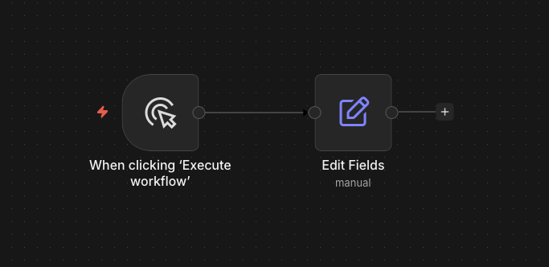

</div>

---

## Demo 1: Workflow แรก

### เป้าหมาย: สร้าง Workflow แรกและตรวจสอบ Output

**ขั้นตอน:**

1. คลิก **"New Workflow"** บน Dashboard
2. คลิก `+` บน Canvas เพื่อเพิ่ม Node
3. ค้นหา **"Manual Trigger"** → เพิ่ม
4. คลิก `+` ต่อจาก Manual Trigger
5. เพิ่ม **"Set"** Node
6. เพิ่ม Field: `message` = `Hello AI Agent Engineering!`
7. กด **"Execute Workflow"** เพื่อรัน

---

## ผลลัพธ์ที่ควรเห็น: Output จาก Set Node

```json
[
  {
      "message": "Hello AI Agent Engineering!"
  }
]
```

### สิ่งที่เรียนรู้

- วิธีสร้าง Workflow ใหม่
- การเพิ่มและเชื่อม Nodes
- การดู Output ของ Nodes

---

<!-- _class: divider -->

## 02
## Trigger Nodes

เริ่มต้น Workflow ด้วย Triggers


---
## Trigger Nodes

<div class="center">

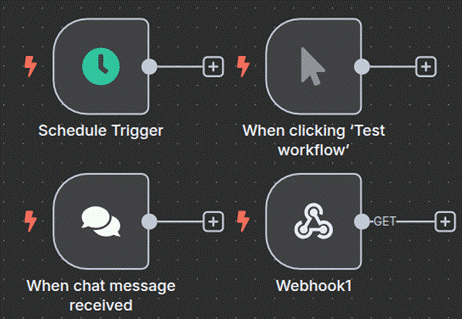

</div>

---

## Schedule Trigger :  รัน Workflow ตามเวลาที่กำหนด

**การตั้งค่า:**
- **Mode:** Every X minutes / hours / days
- **Cron Expression:** สำหรับตั้งเวลาซับซ้อน

| Cron | ความหมาย |
|---|---|
| `0 8 * * 1-5` | ทุกวันทำงาน เวลา 08:00 |
| `0 9 1 * *` | วันที่ 1 ทุกเดือน เวลา 09:00 |
| `0 */4 * * *` | ทุก 4 ชั่วโมง |
| `0 7 * * 1` | ทุกวันจันทร์ เวลา 07:00 |

---

## Webhook Trigger

### รับข้อมูลจากระบบภายนอก

**ใช้เมื่อ:** ต้องการรับ Event จากระบบอื่น เช่น:
- ระบบ CRM ส่ง event เข้ามา
- แบบฟอร์มออนไลน์ Submit
- ระบบอื่น Push ข้อมูลให้

**Webhook URL ตัวอย่าง:**
```
https://your-n8n.example.com/webhook/incoming-event
```

**การทดสอบ:** ใช้ **Test URL** ใน n8n Editor ก่อน Activate

---

<!-- _class: divider -->

## 03
## HTTP Request Node

เรียกข้อมูลจาก REST API


---
## HTTP Request พื้นฐาน

### Demo 2: ดึงข้อมูลจาก Public API

<div class="center">

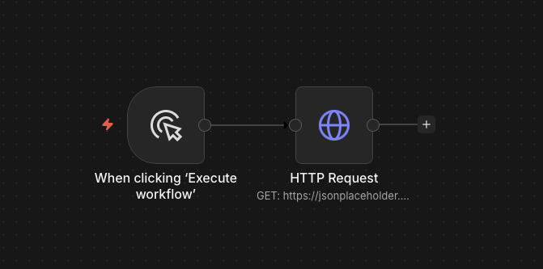

</div>

---

## HTTP Request พื้นฐาน

### Demo 2: ดึงข้อมูลจาก Open Data API

**เป้าหมาย:** เรียกข้อมูลจาก JSONPlaceholder (API ตัวอย่าง)

**การตั้งค่า HTTP Request Node:**
```
Method:  GET
URL:     https://jsonplaceholder.typicode.com/posts
Headers: (ว่าง)
```

**ผลลัพธ์:** รายการโพสต์ 100 รายการในรูปแบบ JSON

---

## HTTP Request กับ Query Parameters

```
Method: GET
URL:    https://dummyjson.com/products
```

**Query Parameters (เพิ่มใน n8n):**

| Name | Value |
|---|---|
| `limit` | `100` |
| `skip` | `0` |

**URL ที่ได้:** https://dummyjson.com/products?limit=100&skip=0

---

## HTTP Request กับ Authentication: การส่ง API Key

**ผ่าน Header:**
```
Header Name:  Authorization
Header Value: Bearer {{ $credentials.apiKey }}
```

**ผ่าน Query Parameter:**
```
Parameter Name:  api_key
Parameter Value: (เลือกจาก Credentials)
```

> **Best Practice:** สร้าง Credential ใน n8n เสมอ อย่า Hardcode API Key ใน Node

---

<!-- _class: divider -->

## 04
## Data Transformation

แปลงและกรองข้อมูลใน n8n

---

## Set Node — กำหนดค่าตัวแปร

### การใช้ Set Node

**Demo 3: สร้างข้อมูลสรุปอย่างง่าย**

```
Field: report_title    → "Monthly Operations Summary"
Field: report_date     → {{ $today }}
Field: data_source     → {{ $json.source }}
Field: total_records   → {{ $json.count }}
```

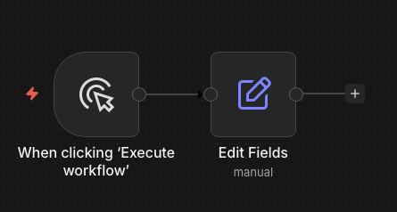

---

## IF Node — เงื่อนไขการทำงาน


**Demo 4: ตรวจสอบค่าผิดปกติ**

```
Condition: {{ $json.stock }} < 20
```
**True Branch** → แจ้งทีมว่าสินค้าใกล้หมด
**False Branch** → ดำเนินการปกติต่อไป

### เงื่อนไขที่รองรับ
- Equal / Not Equal
- Larger / Smaller than
- Contains / Starts With
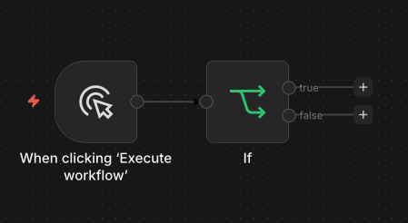
---

## Code Node — เขียน Custom Logic

<div class="columns">
<div>

**Code Node: คำนวณ % การเปลี่ยนแปลง**

```javascript
const items = $input.all();
return items.map(item => {
  const current = item.json.current_value;
  const previous = item.json.previous_value;
  const change = ((current - previous) / 
                  previous * 100).toFixed(2);

```

</div>
<div>

```javascript
  return {
    json: {
      ...item.json,
      percent_change: parseFloat(change),
      trend: change > 0 ? "เพิ่มขึ้น" : "ลดลง"
    }
  };
});
```
</div>
</div>

---

## Filter / Split in Batches

<div class="columns">
<div>

**Filter Node** — กรองข้อมูลตามเงื่อนไข
```
เก็บเฉพาะ: {{ $json.stock }} < 20
```

**Split in Batches** — แบ่งประมวลผลทีละ N รายการ
- ป้องกัน API Rate Limit
- ประมวลผลข้อมูลขนาดใหญ่ได้

</div>
<div>

**Merge Node** — รวมข้อมูลจากหลาย Branch
- Merge by Position
- Merge by Key (JOIN ข้อมูล 2 ชุด)

</div>
</div>

---

<!-- _class: divider -->

## 05
## Output: Database, Email, & File

ส่งออกผลลัพธ์


---

## Data Table
### Demo 5: บันทึกข้อมูลลง Data Table ของ n8n

<div class="center">

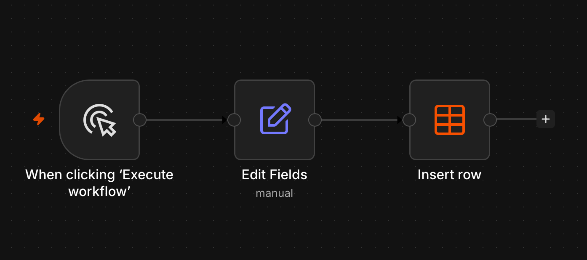

</div>

---

## บันทึกข้อมูลลง Data Table 

<div class="columns">
<div>

### บันทึกข้อมูลลง Data Table
**Data Table Node** — จัดเก็บข้อมูลภายใน n8n
- ใช้เป็นฐานข้อมูลขนาดเล็ก
- เก็บข้อมูลระหว่าง Workflow
- เหมาะกับข้อมูลที่ต้องการความเร็วและไม่ซับซ้อน
- ไม่เหมาะสำหรับข้อมูลขนาดใหญ่
- สามารถใช้ร่วมกับ Workflow อื่นๆ ได้ผ่าน Data Table Node

</div>
<div>

### ตัวอย่างการใช้งาน

```
Operation: Insert
Table Name: customer
Data:
  username → {{ $json.username }}
  gender → {{ $json.gender }}
  age → {{ $json.age }}
``` 
</div>
</div>


---

## Send Mail
### Demo 6: ส่งรายงานทาง Email

<div class="center">

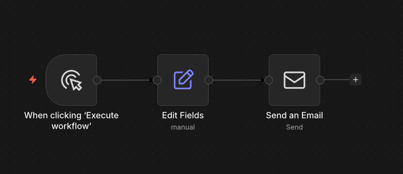

</div>

---

## ส่งรายงานทาง Email

<div class="columns">
<div>

### Send Email Node (SMTP)

**การตั้งค่า Credential:**
- Protocol: SMTP / Gmail / Outlook
- Host, Port, Username, Password

**Attachment:** แนบไฟล์ CSV/Excel ได้

</div>
<div>

**การตั้งค่า Email Node:**
```
To:      team@example.com
Subject: Operations summary {{ $today }}
Body:    สรุปประจำวันนี้: {{ $json.total }}
         ดูรายละเอียดที่ระบบ Dashboard
```

</div>
</div>

---

<div class="columns">

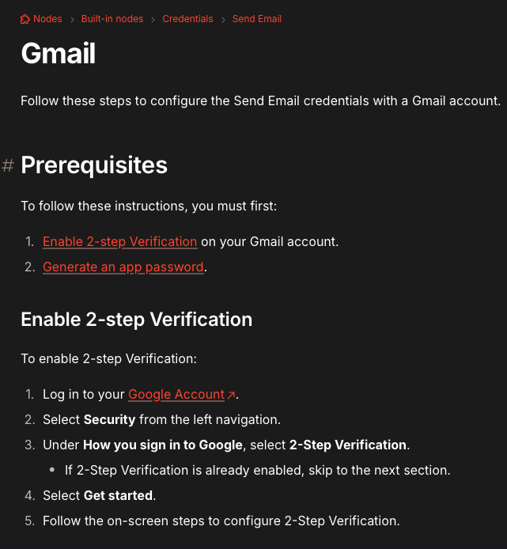

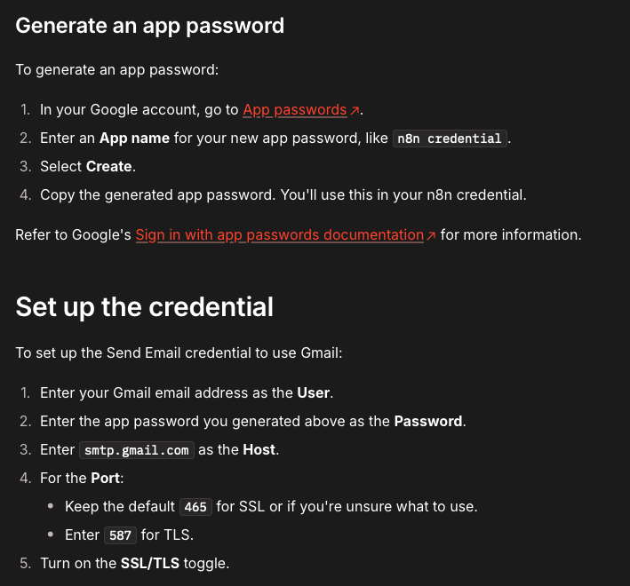

</div>

---

<div class="columns">

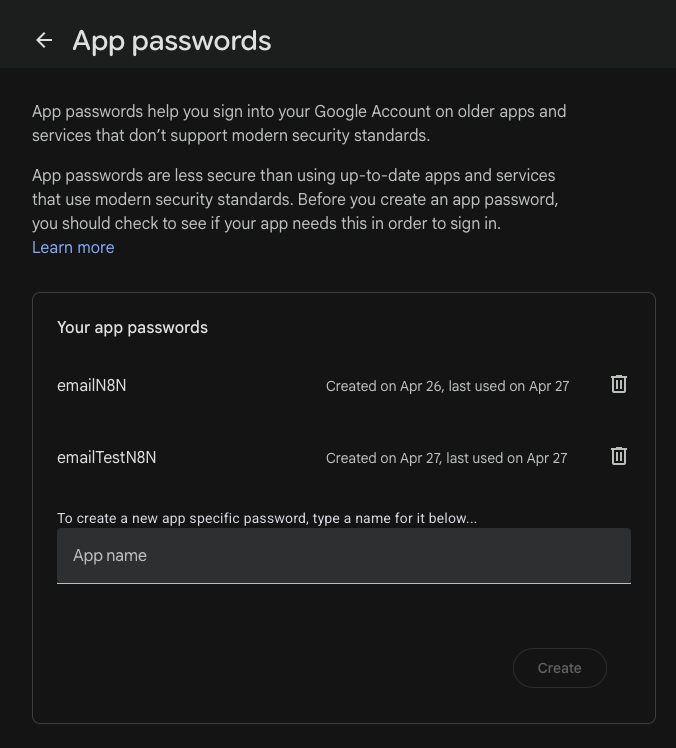

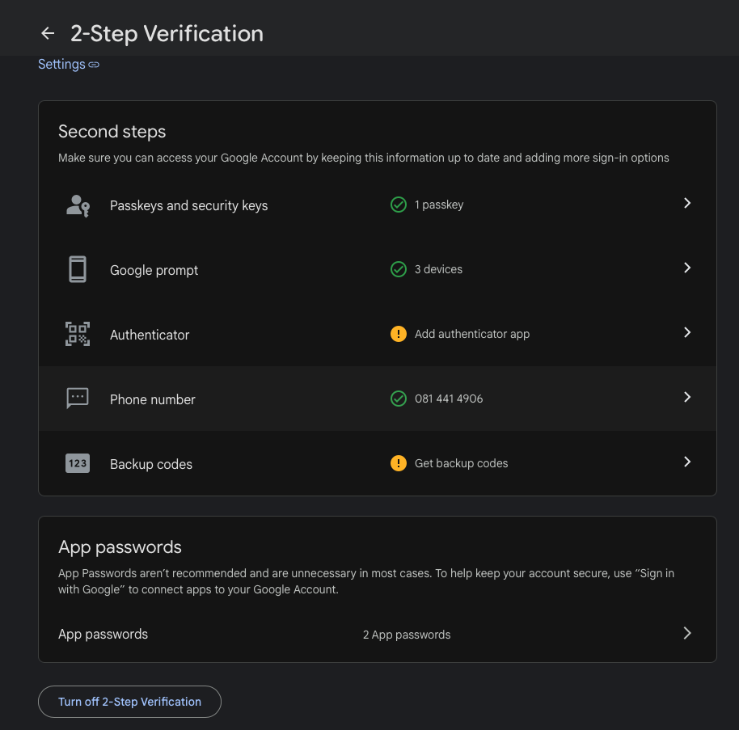

</div>


---

<div class="center">

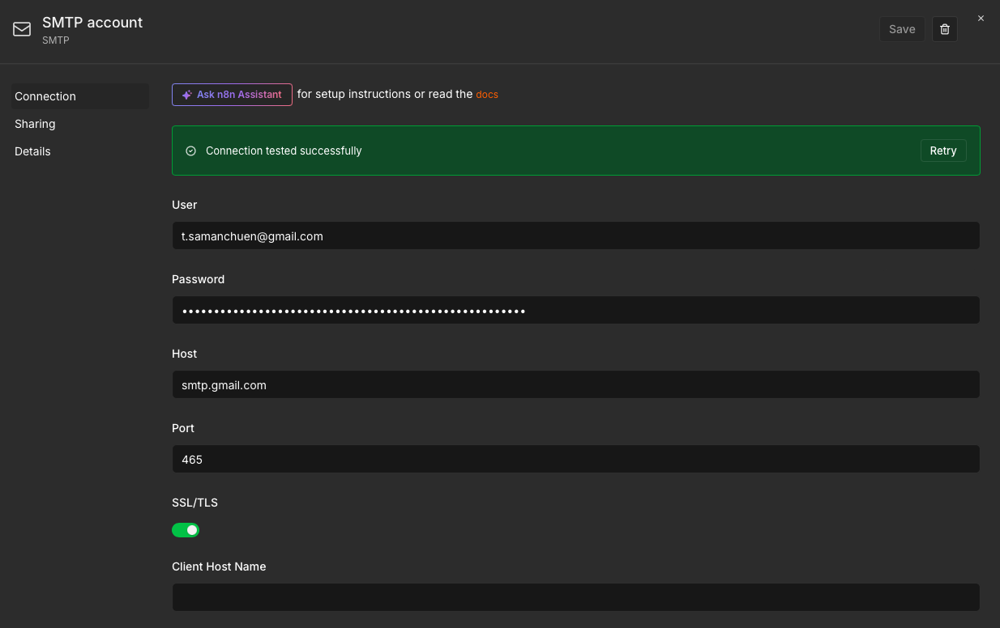

</div>


---

## Google Sheet
### Demo 7: บันทึกข้อมูลลง Google Sheets

<div class="center">

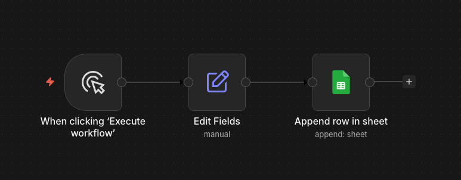

</div>

---

## บันทึกข้อมูลลง Google Sheets

<div class="columns">
<div>

### Google Sheets Node

**การตั้งค่า Credential:**
- Google OAuth2 หรือ Service Account
- แชร์ Sheet ให้ Service Account Email

**Operation:**
- **Append** — เพิ่มข้อมูลแถวใหม่
- **Update** — อัปเดตแถวที่มีอยู่
- **Read** — ดึงข้อมูลจาก Sheet

</div>
<div>

**การตั้งค่า Node:**
```
Operation:    Append
Document ID:  (วาง Google Sheet URL)
Sheet Name:   Sheet1

Columns:
  date     → {{ $today }}
  total    → {{ $json.total }}
  category → {{ $json.category }}
```

</div>
</div>


---

<!-- _class: divider -->

## 06
## Workshop 

ฝึกปฏิบัติ

---

<!-- _class: highlight -->

## Workshop A — รายงานอากาศอัตโนมัติ

<div class="columns">
<div>

### โจทย์

สร้าง Workflow ที่:
1. **ทำงานทุกเช้า** เวลา 07:00 น.
2. **ดึงข้อมูลอากาศ** จาก Open-Meteo API (Free, ไม่ต้องใช้ API Key)
3. **แปลงข้อมูล** — คำนวณค่าเฉลี่ยอุณหภูมิ
4. **ส่ง Email** สรุปสภาพอากาศประจำวัน

</div>
<div>

### API ที่ใช้

```
URL: https://api.open-meteo.com/v1/forecast
Parameters:
  latitude=13.75
  longitude=100.52
  daily=temperature_2m_max,
        temperature_2m_min
  timezone=Asia/Bangkok
```

</div>
</div>

---
## Hint: Workflow for Workshop A

<div class="center">

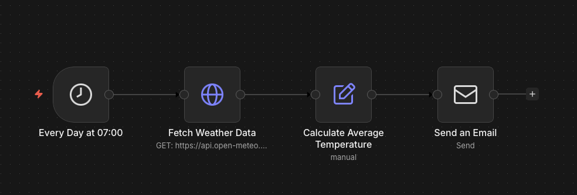

</div>

---

<!-- _class: highlight -->

## Workshop B — Data Cleaning Pipeline

<div class="columns">
<div>

### โจทย์

สร้าง Workflow ที่:
1. **รับข้อมูล** จาก Webhook (จำลองการส่งข้อมูลสำรวจ)
2. **ตรวจสอบ** ว่าข้อมูลครบถ้วน (ไม่มีค่า null)
3. **แยก** ข้อมูล valid / invalid ออกจากกัน
4. **บันทึก** ลงไฟล์ CSV แยก: `valid.csv` และ `invalid.csv`

</div>
<div>

### สิ่งที่ต้องทำ

1. สร้าง Webhook Trigger
2. ใช้ IF Node ตรวจสอบ required fields
3. True Branch → Export `valid.csv` ด้วย Spreadsheet File Node
4. False Branch → Export `invalid.csv` ด้วย Spreadsheet File Node

> **Dataset:** ทดสอบด้วย Postman หรือ curl

</div>
</div>


---
## Hint: Workflow for Workshop B

<div class="center">

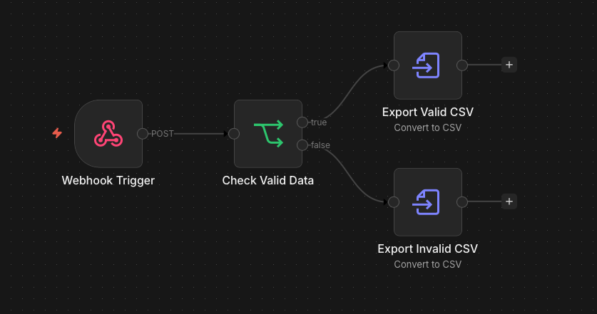

</div>

---
## curl for testing
```bash
curl -X POST "https://itmmu.app.n8n.cloud/webhook-test/survey-data" \
  -H "Content-Type: application/json" \
  -d '{
    "name": "Ake",
    "email": "ake@example.com",
    "feedback": "This is my feedback"
  }'
```

---

<!-- _class: divider -->

## 07
## สรุปและบทเรียนถัดไป

Summary & What's Next

---

## สรุป Module 3

### สิ่งที่เรียนรู้ใน Module นี้

- ✅ **สร้าง Workflow** ตั้งแต่ต้นด้วย Manual & Schedule Trigger
- ✅ **HTTP Request** เรียก REST API พร้อม Authentication
- ✅ **Data Transformation** — Set, IF, Code, Filter Nodes
- ✅ **Output** — ส่ง Email และ Export ไฟล์ Excel/CSV
- ✅ **Workshop** — ฝึกสร้าง Workflow ด้วย API และข้อมูลตัวอย่าง

### Module ถัดไป

**Module 4:** Workshop — สร้าง Data Pipeline เพื่อป้อนข้อมูลให้ AI Agent

---

<!-- _class: lead -->

# เยี่ยมมาก! Workflow แรกสำเร็จแล้ว

**Module 4:** ต่อยอดด้วย Data Pipeline สำหรับ AI Agent

---

<!-- footer: "Mini AI Agent Engineering | Module 4 — Data Pipeline Engineering" -->


<!-- _class: lead -->

<style scoped>
.logo-bar { position: absolute; top: 36px; right: 64px; display: flex; align-items: center; gap: 16px; }
.logo-bar img { width: 100px; height: 100px; object-fit: contain; }
</style>

<div class="logo-bar">
  
</div>

# Workshop: สร้าง Data Pipeline สำหรับ AI Agent

<div class="subtitle">Module 4 — End-to-End Data Pipeline and Tool Engineering</div>

**หลักสูตร** Mini AI Agent Engineering

ผศ. ดร.ทวีศักดิ์ สมานชื่น
CBTU · คณะวิศวกรรมศาสตร์ · มหาวิทยาลัยมหิดล

---

## วัตถุประสงค์การเรียนรู้

เมื่อจบ module นี้ ผู้เรียนสามารถ:

1. **ออกแบบ** Pipeline ดึงข้อมูลจาก API และแหล่งข้อมูลหลายรูปแบบ
2. **ประมวลผล** และ **ตรวจสอบคุณภาพ** ข้อมูลอัตโนมัติ
3. **ตั้งเวลา** ให้ระบบทำงานอัตโนมัติแบบ Scheduled
4. **สร้าง** ผลลัพธ์ที่นำไปใช้ต่อโดย Agent หรือผู้ใช้ได้
5. **จัดการ** Error Handling และ Monitoring

---

## เนื้อหาใน Module นี้

1. **ภาพรวม Pipeline** — Architecture ของระบบ
2. **แหล่งข้อมูลสำหรับ Workshop** — Public APIs และชุดข้อมูลตัวอย่าง
3. **Data Extraction** — ดึงข้อมูลจาก Multiple Sources
4. **Data Processing** — ประมวลผลและสรุปข้อมูล
5. **Reporting & Alerting** — รายงานและแจ้งเตือน
6. **Workshop** — สร้าง Full Pipeline

---

<!-- _class: divider -->

## 01
## Architecture ภาพรวม

AI Agent Data Pipeline Design

---

## Pipeline Architecture

### End-to-End Data Pipeline


<div class="center">

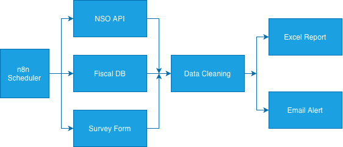

</div>

---

## แหล่งข้อมูลที่จะใช้ใน Workshop

### Public APIs สำหรับงาน Workshop

| แหล่งข้อมูล | URL | ประเภทข้อมูล |
|---|---|---|
| **DummyJSON** | dummyjson.com | Products, carts, users (sample data) |
| **JSONPlaceholder** | jsonplaceholder.typicode.com | Posts, users, comments |
| **Open-Meteo** | api.open-meteo.com | สภาพอากาศ (Free) |
| **Webhook test data** | n8n Form/Webhook | ข้อมูลจำลองจากผู้เรียน |

---

<!-- _class: divider -->

## 02
## แหล่งข้อมูลสำหรับ Workshop

ทดลองเชื่อมต่อ Public API และตรวจสอบโครงสร้างข้อมูล

---

## [dummyjson.com/products](https://dummyjson.com/products)

<div class="columns">
<div>

### สำรวจ API ก่อนสร้าง Workflow

**ขั้นตอนการใช้งาน:**
1. เปิด API Documentation และเลือก Endpoint
2. ตรวจสอบ Response, Pagination และ Rate Limits

</div>
<div>

**ตัวอย่าง API Call:**
```
GET https://dummyjson.com/products?limit=100
```

</div>
</div>

---

## ตัวอย่าง: Product Catalog API

**DummyJSON Products:**
```
GET https://dummyjson.com/products?limit=100
```

**Fields ที่ได้:** `id`, `title`, `category`, `price`, `stock`, `rating`

**โจทย์:** ทำความสะอาดข้อมูลสินค้า คำนวณค่าเฉลี่ยต่อหมวด และแจ้งเตือนเมื่อ stock ต่ำ


---

<!-- _class: divider -->

## 03
## Data Processing

ประมวลผลและทำความสะอาดข้อมูล

---

## Data Cleaning Pipeline

### ขั้นตอนการทำความสะอาดข้อมูล


<div class="center">

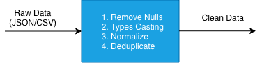

</div>

---
<!-- _class: dense -->
## Code Node: Data Cleaning

<div class="columns">
<div>

### ขั้นตอน

1. **กรอง** ข้อมูลที่ไม่ครบ
2. **แปลงชนิด** String → Number/Date
3. **ตรวจค่า** ที่ไม่สมเหตุสมผล

> Input: JSON จาก HTTP Request
> Output: Array ของ Items ที่สะอาด

</div>
<div>

```javascript
const items = $input.all();
return items
  .filter(item =>
    item.json.title &&
    item.json.price !== null)
  .map(item => ({
    json: {
      title: item.json.title.trim(),
      price: Number(item.json.price),
      stock: Number(item.json.stock),
      updated_at: new Date().toISOString()
    }
  }))
  .filter(item =>
    item.json.price >= 0 &&
    item.json.stock >= 0);
```

</div>
</div>

---
<!-- _class: dense -->
## Code Node:  Data Aggregation

<div class="columns">
<div>

### สิ่งที่คำนวณได้

| ค่า | วิธีคำนวณ |
|---|---|
| `total` | รวมทุก record |
| `avg` | total ÷ จำนวน |
| `max` / `min` | ค่าสูง/ต่ำสุด |
| `by_category` | groupBy หมวดสินค้า |

</div>
<div>

```javascript
const data = $input.all()
  .map(i => i.json);
const values = data.map(d => d.price);
const total = values.reduce((a,b) => a+b, 0);
const avg   = total / values.length;
const max   = Math.max(...values);
const min   = Math.min(...values);
const byCategory = data.reduce((acc, item) => {
  acc[item.category] =
    (acc[item.category] || 0) + item.price;
  return acc;
}, {});
return [{ json: { total, avg, max, min,
                  by_category: byCategory } }];
```

</div>
</div>

---

## Join ข้อมูลจากหลายแหล่ง

### Merge Node — รวมข้อมูล 2 ชุด

**กรณีการใช้งาน:** รวมรายการสินค้า + รายละเอียดคำสั่งซื้อ

```
[Products API] ──┐
                 ├──► [Merge Node] ──► [Code: สรุปยอดตามสินค้า]
[Carts API]    ──┘     (Join by "productId")
```

**การตั้งค่า Merge Node:**
- **Mode:** Combine
- **Combine By:** Matching Rules
- **Fields to Match:** `id` = `productId`

---

<!-- _class: divider -->

## 04
## Reporting & Alerting

สร้างรายงานและระบบแจ้งเตือน

---

## สร้างรายงาน Excel อัตโนมัติ

### Workflow: Monthly Report Generation


<div class="center">

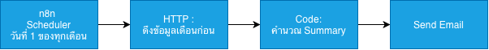

</div>


---

<!-- _class: dense -->

## Template รายงาน HTML Email

<div class="columns">
<div>

**โครงสร้าง Email:**
- `<h2>` — หัวข้อรายงาน
- `<table>` — ตารางข้อมูล
- Header row สี `#1B4F72`
- ใส่ n8n expressions `{{ }}` ในแต่ละ cell

> ใช้ใน **Send Email Node**
> ช่อง Body → HTML mode

</div>
<div>

```html
<h2>Monthly Operations Summary — {{ $json.month }}</h2>
<table border="1"
  style="border-collapse:collapse;width:100%">
  <tr style="background:#1B4F72;color:white">
    <th>ตัวชี้วัด</th>
    <th>ค่า</th>
    <th>เปลี่ยนแปลง</th>
  </tr>
  <tr>
    <td>ราคาเฉลี่ยสินค้า</td>
    <td>{{ $json.avg_price }}</td>
    <td>{{ $json.price_change }}%</td>
  </tr>
</table>
```

</div>
</div>

---


## ระบบแจ้งเตือนความผิดปกติ : Psuedo Code

```
สำหรับแต่ละ item:
  คำนวณ pct = |value - previous| / previous × 100
  ถ้า pct > threshold:
    สร้าง alert:
      - indicator = ชื่อตัวชี้วัด
      - message   = "เปลี่ยนแปลง X%"
      - severity  = HIGH  (ถ้า pct > threshold × 2)
                    MEDIUM (อื่นๆ)
    เพิ่มเข้า alerts[]
ถ้า alerts ไม่ว่าง → return alerts
ไม่มี alert        → return { no_alerts: true }
```

---

## Integration กับช่องทางอื่น

<div class="columns">
<div>

**LINE Notify:**
```
POST https://notify-api.line.me/api/notify
Header: Authorization: Bearer {LINE_TOKEN}
Body:   message={{ $json.message }}
```

**Slack:**
- ใช้ Slack Node ใน n8n โดยตรง

</div>
<div>

**Microsoft Teams (Webhook):**
```json
POST https://your-org.webhook.office.com/...
{
  "text": "Daily operations summary\n{{ $json.summary }}"
}
```

</div>
</div>

---

<!-- _class: divider -->

## 05
## Workshop Exercise

สร้าง Production-minded Data Pipeline

---

<!-- _class: highlight -->

## Workshop A — Product Catalog Pipeline

### โจทย์: สร้าง Automated Pipeline จาก Product Catalog
```
GET https://dummyjson.com/products?limit=100
```

1. ดึงข้อมูลสินค้าจาก Public API และจัดการ Pagination
2. ตรวจสอบ required fields และแปลงชนิดข้อมูล
3. คำนวณจำนวนสินค้าและราคาเฉลี่ยแยกตามหมวด
4. แยกสินค้า stock ต่ำและ TOP 5 ตาม rating
5. สร้าง Summary Report และแจ้งเตือนทีม

---

## โครงสร้างข้อมูล Product Dataset


| ฟิลด์ | ชนิด | ตัวอย่างค่า | ความหมาย |
|---|---|---|---|
| `id` | numeric | `1` | รหัสสินค้า |
| `title` | text | `"Essence Mascara"` | ชื่อสินค้า |
| `category` | text | `"beauty"` | หมวดสินค้า |
| `price` | numeric | `9.99` | ราคา |
| `stock` | numeric | `99` | จำนวนคงเหลือ |
| `rating` | numeric | `4.5` | คะแนนรีวิว |

> API ส่งข้อมูลตัวอย่างกลับมาใน JSON; ตรวจ Response จริงก่อนนำไปใช้

---
<!-- _class: dense -->
## Hint: ขั้นตอนที่ 1 — HTTP Request Node

### ตั้งค่า HTTP Request และตรวจสอบ Response

**วิธีที่ 1 — Query String (เร็ว, Filter ฝั่ง Server):**
```
Method:  GET
URL:     https://dummyjson.com/products?limit=100&skip=0
```


---
<!-- _class: dense -->
## Hint: Workshop A

### Workflow Structure

<div class="center">

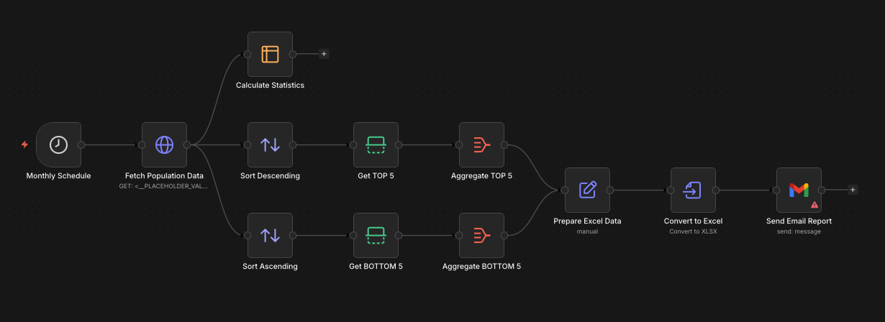

</div>


---

<!-- _class: highlight -->

## Workshop B — Product and Cart Analysis Pipeline

### โจทย์: รวมข้อมูลสินค้าและตะกร้าสั่งซื้อจาก Public API


| | Dataset | API endpoint |
|---|---|---|
| **ชุดที่ 1** | Product catalog พร้อมหมวด ราคา และจำนวนคงเหลือ | `https://dummyjson.com/products?limit=100` |
| **ชุดที่ 2** | Carts พร้อมรายการและยอดสั่งซื้อ | `https://dummyjson.com/carts?limit=100` |

**ความต้องการ:**
1. ดึงข้อมูลจาก 2 API พร้อมกัน (Parallel) และจัดการ Error แยกกัน
2. รวมข้อมูลตะกร้ากับสินค้าโดยใช้ `productId`
3. คำนวณยอดสั่งซื้อและหาสินค้าที่ถูกสั่งซื้อมากที่สุด
4. สร้าง Summary Report พร้อมเวลาที่ดึงข้อมูล

---

## โครงสร้างข้อมูล: ชุดที่ 1 — Products

| ฟิลด์ | ชนิด | ตัวอย่างค่า |
|---|---|---|
| `id` | numeric | `1` |
| `title` | text | `"Sample product"` |
| `category` | text | `"beauty"` |
| `price` | numeric | `9.99` |
| `stock` | numeric | `99` |

```
GET https://dummyjson.com/products?limit=100
```

---

## โครงสร้างข้อมูล: ชุดที่ 2 — Carts

| ฟิลด์ | ชนิด | ตัวอย่างค่า |
|---|---|---|
| `id` | numeric | `1` |
| `userId` | numeric | `1` |
| `products[].id` | numeric | `1` |
| `products[].quantity` | numeric | `2` |
| `total` | numeric | `19.98` |

```
GET https://dummyjson.com/carts?limit=100
```

---
<!-- _class: dense -->
## Hint: ขั้นตอนที่ 1 — ดึงข้อมูล 2 แหล่งพร้อมกัน

### Workflow Structure (Parallel HTTP Requests)


<div class="center">

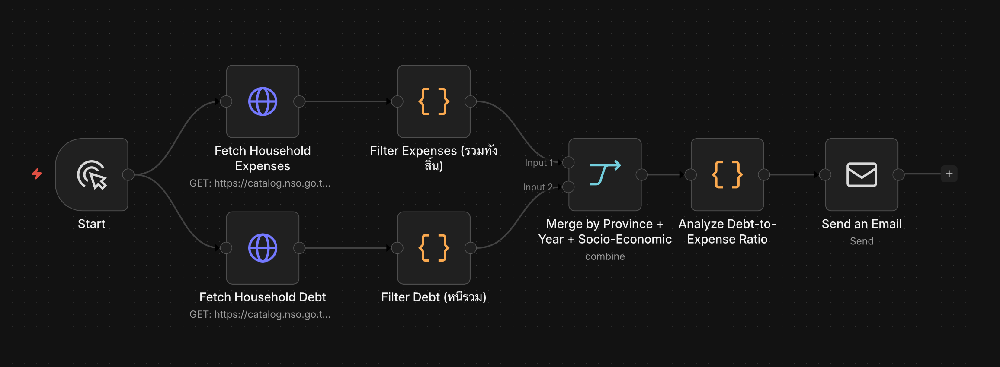

</div>

---

<!-- _class: divider -->

## 06
## Best Practices & Production Tips

แนวทางปฏิบัติที่ดีสำหรับ Production

---

## Best Practices

### การพัฒนา Workflow คุณภาพสูง

<div class="columns">
<div>

**1. ตั้งชื่อ Node ให้ชัดเจน**
- ❌ `HTTP Request 1`, `Set 3`
- ✅ `GET Population Data`, `Calculate Summary Stats`

**2. ใช้ Notes (Sticky Notes)**
- อธิบาย Logic ซับซ้อน
- บันทึก API Documentation Reference

</div>
<div>

**3. แยก Workflow ตามหน้าที่**
- Workflow หลัก (Main Pipeline)
- Workflow Error Handler แยกต่างหาก
- Workflow Utility Functions

</div>
</div>

---

## Security Best Practices

### ความปลอดภัยสำหรับ Workflow ที่ใช้งานจริง

- 🔑 **ใช้ Credentials เสมอ** — ห้าม Hardcode API Key
- 🔒 **HTTPS เท่านั้น** สำหรับ API ภายนอก
- 🏛️ **Deployment** — เลือก Self-hosted หรือ Cloud ตามความเสี่ยงและข้อกำหนด
- 👤 **Role-Based Access** — ตั้ง Permission ผู้ใช้ n8n
- 📋 **Audit Log** — เปิด Execution History ทุก Workflow
- 🔄 **Backup** — Backup n8n Database สม่ำเสมอ

---

## สรุป Module 4

### สิ่งที่เรียนรู้ใน Module นี้

- ✅ **Pipeline Architecture** ออกแบบระบบ End-to-End
- ✅ **Public APIs** และการจัดการข้อมูลจากหลายแหล่ง
- ✅ **Data Cleaning & Aggregation** ด้วย Code Node
- ✅ **Merge ข้อมูล** จากหลายแหล่งด้วย Merge Node
- ✅ **Excel Report + Email** ส่งรายงานอัตโนมัติ
- ✅ **Security Best Practices** สำหรับ Workflow ที่ใช้งานจริง


---

<!-- footer: "Mini AI Agent Engineering | Module 5 — LLM and Structured Outputs" -->


<!-- _class: lead -->

<style scoped>
.logo-bar { position: absolute; top: 36px; right: 64px; display: flex; align-items: center; gap: 16px; }
.logo-bar img { width: 100px; height: 100px; object-fit: contain; }
</style>

<div class="logo-bar">
  
</div>

# Workshop: ใช้ LLM วิเคราะห์ข้อความอย่างมีโครงสร้าง

<div class="subtitle">Module 5 — Prompt Engineering, Classification and Structured Output</div>

**หลักสูตร** Mini AI Agent Engineering

ผศ. ดร.ทวีศักดิ์ สมานชื่น
CBTU · คณะวิศวกรรมศาสตร์ · มหาวิทยาลัยมหิดล

---

## วัตถุประสงค์การเรียนรู้

เมื่อจบ module นี้ ผู้เรียนสามารถ:

1. **ออกแบบ** Prompt สำหรับงานจำแนกและสกัดข้อมูลจากข้อความ
2. **สร้าง** LLM Workflow ที่คืนผลลัพธ์แบบมีโครงสร้าง
3. **กำหนด** Schema และตรวจสอบผลลัพธ์ก่อนส่งต่อ
4. **ประมวลผล** ข้อความตัวอย่างและจัดการกรณีผิดพลาด
5. **ประเมิน** คุณภาพผลลัพธ์และข้อจำกัดของโมเดล

---

## เนื้อหาใน Module นี้

1. **LLM Extraction & Classification** — เข้าใจงานและกำหนดผลลัพธ์
2. **Prompt Engineering** — ออกแบบคำสั่งให้ได้ผลลัพธ์สม่ำเสมอ
3. **Workshop Part A:** จำแนกข้อความ Feedback
4. **Workshop Part B:** สกัดประเด็นและเร่งส่งต่อกรณีเร่งด่วน
5. **Structured Output & Evaluation** — ตรวจสอบผลและวัดคุณภาพ

---

<!-- _class: divider -->

## 01
## Structured Text Analysis

LLM Classification and Extraction

---

## วิเคราะห์ Feedback ด้วย LLM

### การวิเคราะห์ความคิดเห็นอัตโนมัติ

- **Sentiment Analysis** — จำแนกข้อความว่า "บวก / กลาง / ลบ" โดยอัตโนมัติ
- **Use Case** — จัดหมวดหมู่ Feedback และค้นหาประเด็นที่ควรติดตาม
- **Traditional vs AI** — จากคีย์เวิร์ดธรรมดา สู่ LLM ที่เข้าใจบริบทภาษาไทย

### ความแตกต่างของ Sentiment

| ระดับ | ตัวอย่างข้อความ | ความหมาย |
|---|---|---|
| **Positive** | "ใช้งานง่ายและส่งไว" | พอใจ / ชื่นชม |
| **Neutral** | "ได้รับสินค้าตามรายการ" | กลาง / ไม่แสดงความรู้สึก |
| **Negative** | "ตั้งค่าไม่ผ่านและคู่มือไม่ชัด" | ไม่พอใจ / ต้องปรับปรุง |

---

## ทำไมต้องใช้ AI สำหรับภาษาไทย?

### ความซับซ้อนของภาษาไทย

- 🗣️ **ภาษาพูด vs ภาษาเขียน** — ความแตกต่างสูงในการสื่อสาร
- 🔄 **บริบทมีผล** — "ดีนะ" อาจเป็นการเสียดีได้
- 📝 **คำย่อ / ภาษาสแลง** — ใช้กันทั่วไปในแบบประเมิน
- 🤖 **LLM เข้าใจบริบท** — GPT / Claude วิเคราะห์ได้แม่นกว่า Keyword Matching

### n8n + AI Integration

```
รับข้อความ → ส่งให้ LLM (via n8n AI Node) → ได้ผล Sentiment + เหตุผล
```

---
## Prompt Engineering: Prompt Template 
> **System Message:** คุณเป็นผู้เชี่ยวชาญวิเคราะห์ความคิดเห็นภาษาไทย ตอบเฉพาะในรูปแบบ JSON เท่านั้น  
> รูปแบบ: `{ "sentiment": "positive|neutral|negative", "score": 1-10, "summary": "สรุปสั้นๆ", "category": "หมวดหมู่" }`

> **User:**  `วิเคราะห์ความคิดเห็นนี้: "สินค้าดีมาก แต่คู่มือการตั้งค่าไม่ชัด"`

> **AI:** 
>  ```json
> { "sentiment": "neutral", "score": 5,
>   "summary": "พนักงานบริการดี แต่มีปัญหาเรื่องเวลารอ",
>   "category": "เวลารอ / ขั้นตอน" }


---
## Prompt Engineering
### หลักการ Prompt ที่ดี
- กำหนด Role ชัดเจน
- ระบุ Output Format (JSON)
- ให้ตัวอย่าง (Few-shot) ถ้าจำเป็น


---

<!-- _class: divider -->

## 02
## Prompt Engineering สำหรับ Classification

การออกแบบ Prompt เพื่อวิเคราะห์ภาษาไทย

---

## หลักการเขียน Prompt สำหรับ Classification

### Structured Prompt Template

```text
คุณเป็นผู้เชี่ยวชาญวิเคราะห์ความคิดเห็นภาษาไทย
วิเคราะห์ข้อความต่อไปนี้และตอบในรูปแบบ JSON: 
{
  "sentiment": "positive" | "neutral" | "negative",
  "score": 1-10,
  "summary": "สรุปสั้นๆ",
  "category": "หมวดหมู่ปัญหา"
}
```


---

<!-- _class: divider -->

## 03
## Workshop Part A

สร้าง Workflow วิเคราะห์ Feedback

---

## Workshop A: Structured Feedback Analysis Workflow


###  Workflow
<div class="center">

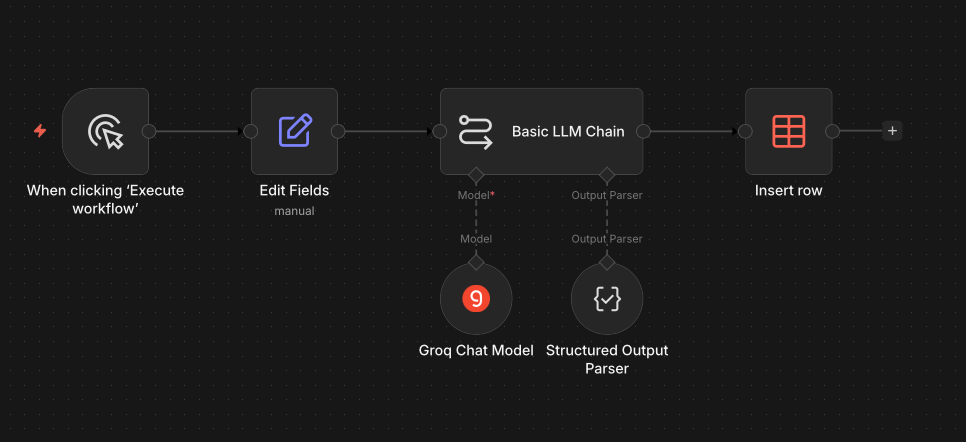

</div>


---

## ตัวอย่างผลลัพธ์ Workshop A

### Input → Output

**Input ข้อความ:** `"สินค้าดีมาก แต่คู่มือการตั้งค่าไม่ชัด"`

**Output จาก LLM:**
```json
{
  "sentiment": "neutral",
  "score": 5,
  "summary": "พอใจกับสินค้า แต่คู่มือการตั้งค่าควรปรับปรุง",
  "category": "คู่มือการใช้งาน"
}
```

---
## ตัวอย่างผลลัพธ์ Workshop A (ต่อ) 

**บันทึกลง Google Sheets** → คอลัมน์: วันที่, ข้อความ, Sentiment, Score, Summary, Category

> Note: Score ที่ได้จากการทำงานของ LLM ไม่ได้เป็นผลการคำนวณแต่เป็นการประมาณค่าของ LLM ต้องระมัดระวังในการนำไปใช้งาน

---

<!-- _class: divider -->

## 04
## Workshop Part B

ประมวลผล Product Feedback (ชุดข้อมูลตัวอย่าง)

---

## Workshop B: Feedback Classification Pipeline

### ประมวลผล Feedback แบบ Batch พร้อมตรวจสอบผลลัพธ์
Data : [Sentiment Data (Click!!!)](https://docs.google.com/spreadsheets/d/1RhQWTeL1bKHKBOYOZRroSpC8VWmeCPMCMjfuFXqMhDA/edit?usp=sharing)
### โครงสร้างข้อมูลตัวอย่าง

| ฟิลด์ | คำอธิบาย | ตัวอย่าง |
|---|---|---|
| `id` | รหัส Feedback | `FB-001` |
| `product` | หมวดสินค้าหรือบริการ | `mobile app` |
| `feedback` | ข้อความความคิดเห็น | "ใช้งานง่าย แต่คู่มือไม่ชัด" |
| `rating` | คะแนน 1–5 (ถ้ามี) | `4` |
| `date` | วันที่รับ Feedback | `2025-01-15` |

---

## โครงสร้าง Workflow Batch Processing

### Workshop B Workflow

<div class="center">

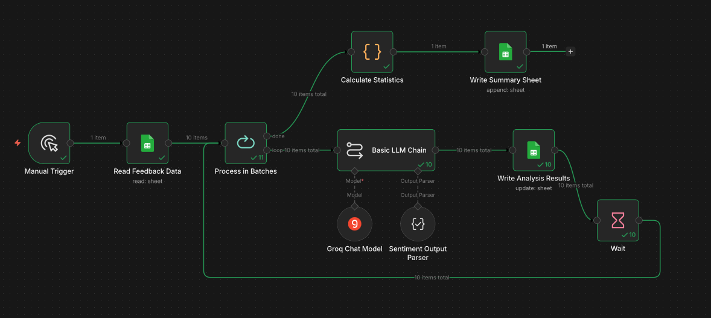

</div>


---

## ขั้นตอน Workshop B — Step by Step

### Step 1–3: โหลดข้อมูล

1. **Manual Trigger** — กด Execute ครั้งเดียวประมวลผลทั้งหมด
2. **Google Sheets Node** — อ่าน Sheet `feedback` ตามจำนวนข้อมูลตัวอย่าง
3. **SplitInBatches Node** — ตั้ง `batch size = 10` เพื่อไม่ให้ API เกิน Rate Limit

### Step 4–6: ประมวลผลและสรุป

4. **AI/LLM Node** — ส่ง `feedback` ทีละรายการ รับ sentiment + score
5. **Code Node** — คำนวณสัดส่วน Sentiment และตรวจผลที่ขาด/ผิด Schema
6. **Google Sheets** — บันทึกผลพร้อมสถานะการตรวจสอบ

---

## รูปแบบผลสรุปจากการ Run

### Summary Dashboard (Google Sheets)

| หมวดหมู่ | จำนวน | % |
|---|---|---|
| **Positive** | คำนวณจากผลจริง | คำนวณจากผลจริง |
| **Neutral** | คำนวณจากผลจริง | คำนวณจากผลจริง |
| **Negative** | คำนวณจากผลจริง | คำนวณจากผลจริง |
| **Invalid / Needs Review** | คำนวณจากผลจริง | — |

> ตรวจผลลัพธ์ตัวอย่างด้วยคนก่อนนำไปใช้ตัดสินใจ และอย่าถือคะแนนที่ LLM สร้างเป็นค่าที่วัดได้จริง

---

## Tips: Batch Processing ใน n8n

### ปัญหาที่พบบ่อยและวิธีแก้

- ⏱️ **Rate Limit** — ใช้ `Wait Node` หน่วง 1 วินาทีระหว่าง batch
- ❌ **LLM Error** — ใช้ `Error Trigger` + Retry logic
- 📏 **Token Limit** — ตัดข้อความที่ยาวเกิน 500 ตัวอักษรก่อนส่ง
- 🔄 **ข้อมูลไม่สม่ำเสมอ** — ใช้ `IF Node` จัดการ null/empty fields

### Best Practice
```
ทดสอบด้วยตัวอย่างจำนวนน้อย → ตรวจสอบ Output → แล้วค่อยประมวลผลทั้งชุด
```

---

<!-- _class: divider -->

## 05
## สรุปและบทเรียนถัดไป

Summary & What's Next

---

## สรุป Module 5

### สิ่งที่เรียนรู้ใน Module นี้

- ✅ **LLM Classification** — จำแนก Feedback ภาษาไทยเป็นผลลัพธ์ที่มีโครงสร้าง
- ✅ **Prompt Engineering** — ออกแบบ Prompt ให้ได้ผล JSON มีโครงสร้าง
- ✅ **Workshop A** — Webhook → LLM → Google Sheets แบบ Real-time
- ✅ **Workshop B** — Batch Processing พร้อมจัดการ Rate Limit และ Error
- ✅ **Evaluation** — ตรวจ Schema, Error Cases และสัดส่วนผลลัพธ์จริง

### Module ถัดไป

**Module 6:** Security and Responsible AI — ปกป้องข้อมูลและกำหนด Guardrails

---

<!-- _class: lead -->

# Workshop สำเร็จ!

**Module 6:** Security and Responsible AI

ข้อมูลและการเรียกใช้ Tools ต้องออกแบบให้ปลอดภัย

---

<!-- footer: "Mini AI Agent Engineering | Module 6 — Security and Responsible AI" -->


<!-- _class: lead -->

<style scoped>
.logo-bar { position: absolute; top: 36px; right: 64px; display: flex; align-items: center; gap: 16px; }
.logo-bar img { width: 100px; height: 100px; object-fit: contain; }
</style>

<div class="logo-bar">
  
</div>

# Security and Responsible AI

<div class="subtitle">Module 6 — ปกป้องข้อมูลและออกแบบ Guardrails สำหรับ AI Agent</div>

**หลักสูตร** Mini AI Agent Engineering

ผศ. ดร.ทวีศักดิ์ สมานชื่น
CBTU · คณะวิศวกรรมศาสตร์ · มหาวิทยาลัยมหิดล

---

## วัตถุประสงค์การเรียนรู้

เมื่อจบ module นี้ ผู้เรียนสามารถ:

1. **อธิบาย** ความเสี่ยงด้านข้อมูลและความเป็นส่วนตัวในการใช้ AI
2. **จำแนก** ข้อมูลส่วนบุคคลและข้อมูลอ่อนไหวตาม PDPA
3. **ใช้งาน** Crypto Node และ Code Node ใน n8n สำหรับการเข้ารหัส
4. **ออกแบบ** Workflow ที่ปลอดภัยด้วย Credential Management
5. **ประยุกต์** Best Practices ด้านความปลอดภัยและ Responsible AI

---

## เนื้อหาใน Module นี้

1. **ทำไมต้องปกป้องข้อมูล?** — PDPA และความเสี่ยงของ AI
2. **ประเภทของข้อมูลสำคัญ** — Sensitive Data Classification
3. **Encryption Methods** — Symmetric, Hashing, และ Tokenization
4. **Workshop:** ออกแบบ Secure Workflow และ Agent Guardrails
5. **Credential Management** — จัดการ API Key และ Password อย่างปลอดภัย

---

<!-- _class: divider -->

## 01
## ทำไมต้องเข้ารหัส?

Data Protection for AI Workflows

---

## ข้อมูลและความเสี่ยงใน Workflow

### สถานการณ์ที่เกิดขึ้นได้

- 📋 **ข้อมูลส่วนบุคคล** รั่วไหลระหว่างส่ง Workflow
- 🔑 **API Key / Password** ถูก Expose ใน Log
- 📊 **ข้อมูลธุรกิจหรือข้อมูลลูกค้า** ถูกส่งผ่าน Webhook ที่ไม่ปลอดภัย
- 🗃️ **ไฟล์สำรอง (Backup)** ไม่ได้เข้ารหัส ใครก็เปิดได้

### หลักการที่เกี่ยวข้อง

| ข้อกำหนด/หลักการ | สาระสำคัญ |
|---|---|
| **PDPA (พ.ร.บ. คุ้มครองข้อมูลส่วนบุคคล)** | ใช้ข้อมูลส่วนบุคคลตามวัตถุประสงค์และปกป้องจากการเข้าถึงโดยไม่ได้รับอนุญาต |
| **Security by Design** | ลดการเก็บข้อมูล จำกัดสิทธิ์ และป้องกันความลับตลอดวงจรข้อมูล |

---

## ข้อมูลที่ต้องปกป้อง (PDPA)

### Sensitive Data Categories

| ประเภท | ตัวอย่าง | ระดับความเสี่ยง |
|---|---|---|
| **ข้อมูลส่วนบุคคลทั่วไป** | ชื่อ, อีเมล, เบอร์โทร | Medium |
| **ข้อมูลส่วนบุคคลอ่อนไหว** | เลขบัตรประชาชน, สุขภาพ | High |
| **ข้อมูลทางการเงิน** | เลขบัญชี, รายได้ | High |
| **ข้อมูลลับทางธุรกิจ** | ข้อมูลลูกค้า สัญญา หรือแผนธุรกิจ | Critical |
| **Credentials** | API Key, Password, Token | Critical |

---

<!-- _class: divider -->

## 02
## Encryption Methods

วิธีการเข้ารหัสที่ควรรู้

---

## 3 วิธีหลักในการปกป้องข้อมูล

<div class="columns">
<div>

### 🔒 Symmetric Encryption (AES)
- ใช้ Key เดียวทั้งเข้าและถอดรหัส
- **ถอดรหัสได้** — ต้องมี Secret Key
- เหมาะกับ: เลขบัตรประชาชน, ข้อมูลที่ต้องนำกลับมาใช้
- ใน n8n: Code Node + `crypto` module

### #️⃣ Hashing (SHA-256 / bcrypt)
- เปลี่ยนข้อมูลเป็น Hash **ย้อนกลับไม่ได้**
- เหมาะกับ: Password, Checksum
- ตรวจสอบความถูกต้องโดยไม่ต้องเห็นข้อมูลเดิม

</div>
<div>

### 🎫 Tokenization
- แทนข้อมูลจริงด้วย Token สุ่ม
- เหมาะกับ: บัตรเครดิต, เลขบัตรประชาชน แบบ Reference
- ข้อมูลจริงเก็บในระบบแยก (Token Vault)


</div>
</div>

---

## เปรียบเทียบ


| วิธี | ถอดรหัส? | ใช้เมื่อ |
|---|---|---|
| AES | ✅ | ต้องการข้อมูลเดิม |
| SHA-256 | ❌ | ตรวจสอบเท่านั้น |
| Token | ✅ (via vault) | Reference ปลอดภัย |

---

<!-- _class: divider -->

## 03
## Workshop: Encryption ใน n8n

ปกป้องข้อมูลใน Workflow อัตโนมัติ

---

## Workshop: เข้ารหัสข้อมูลด้วย Code Node

### โครงสร้าง Workflow

<div class="center">

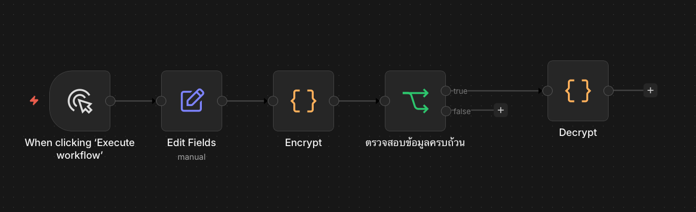

</div>

### ข้อมูลที่รับเข้ามา (Input)
```json
{ "name": "Sample User", "id_card": "<redacted>", "email": "user@example.com" }
```
---
<!-- _class: dense -->
## Code Node: AES Encryption

```javascript
const crypto = require('crypto');
const SECRET_KEY = $vars.ENCRYPTION_KEY; // 32-byte key จาก n8n Environment
const IV = crypto.randomBytes(16);
function encrypt(text) {
  const cipher = crypto.createCipheriv('aes-256-cbc', Buffer.from(SECRET_KEY), IV);
  let encrypted = cipher.update(text, 'utf8', 'hex');
  encrypted += cipher.final('hex');
  return IV.toString('hex') + ':' + encrypted;
}
return {
  json: {
    name: $json.name,           // เก็บชื่อตามปกติ
    id_card_encrypted: encrypt($json.id_card),  // เข้ารหัสเลขบัตร
    email_hash: crypto.createHash('sha256').update($json.email).digest('hex'),
  }
};
``` 
<!-- 
---
## Code Node: ถอดรหัส (Decrypt)
```javascript
const crypto = require('crypto');
const SECRET_KEY = $env.ENCRYPTION_KEY;
function decrypt(encryptedText) {
  const [ivHex, encrypted] = encryptedText.split(':');
  const iv = Buffer.from(ivHex, 'hex');
  const decipher = crypto.createDecipheriv('aes-256-cbc', Buffer.from(SECRET_KEY), iv);
  let decrypted = decipher.update(encrypted, 'hex', 'utf8');
  decrypted += decipher.final('utf8');
  return decrypted;
}
return [{
  json: {
    id_card_original: decrypt($input.item.json.id_card_encrypted)
  }
}];
```

> **สำคัญ:** Secret Key ต้องเก็บใน n8n Environment Variables เท่านั้น ห้ามใส่ใน Code โดยตรง 

-->


---

<!-- _class: divider -->

## 04
## Credential Management

จัดการ Key และ Secret อย่างปลอดภัยใน n8n

---

## n8n Credential System

### วิธีจัดการ Credential ที่ถูกต้อง

- 🔐 **n8n Credentials** — เก็บ API Key, Password ใน Vault ของ n8n (เข้ารหัสอัตโนมัติ)
- 🌍 **Environment Variables** — เก็บ Secret ที่ไม่ควรอยู่ใน Workflow เช่น `ENCRYPTION_KEY`
- 🚫 **อย่าเก็บใน Node** — ไม่ควร Hardcode key ใน Set Node หรือ Code โดยตรง

### การตั้งค่า Environment Variables ใน n8n

```bash
# ตั้งค่าในตัวแปรใน Variables
ENCRYPTION_KEY=your-32-byte-secret-key-here
```

---

## Secure Workflow Checklist

### ตรวจสอบก่อน Deploy Workflow

- [ ] API Key ทุกตัวเก็บใน n8n Credentials — ไม่ใช่ใน Node Text
- [ ] ข้อมูลส่วนบุคคล (PII) ถูกเข้ารหัสก่อนบันทึก
- [ ] ไม่มี Sensitive Data ปรากฏใน Execution Log
- [ ] Webhook มีการตรวจสอบ Authorization Header
- [ ] Environment Variables ใช้สำหรับ Secret Keys

> **Webhook Security:** ใช้ `Header Auth` หรือ `Basic Auth` กับ n8n Webhook เสมอ

---

<!-- _class: divider -->

## 05
## สรุปและบทเรียนถัดไป

Summary & What's Next

---

## สรุป Module 6

### สิ่งที่เรียนรู้ใน Module นี้

- ✅ **ความสำคัญ** ของการปกป้องข้อมูลตาม PDPA และกฎหมายไซเบอร์
- ✅ **ประเภทข้อมูล** ที่ต้องปกป้องและจำกัดการเข้าถึง
- ✅ **AES Encryption** — เข้า/ถอดรหัสด้วย Code Node ใน n8n
- ✅ **SHA-256 Hashing** — ตรวจสอบความถูกต้องและเก็บ Password
- ✅ **Credential Management** — จัดการ Key อย่างปลอดภัยใน n8n

### Module ถัดไป

**Module 7:** Build an AI Agent on n8n — สร้าง Agent ที่มี Memory และ Tools


---

<!-- _class: lead -->

# จบ Day 1 แล้ว!

**พรุ่งนี้ Day 2:** ออกแบบ AI Agent, Tools, RAG และการประเมินผล

ขอบคุณทุกท่านที่ตั้งใจเรียน — พบกันพรุ่งนี้ 09.00 น.

---

<!-- footer: "Mini AI Agent Engineering | Module 7 — Build an AI Agent" -->


<!-- _class: lead -->

<style scoped>
.logo-bar { position: absolute; top: 36px; right: 64px; display: flex; align-items: center; gap: 16px; }
.logo-bar img { width: 100px; height: 100px; object-fit: contain; }
</style>

<div class="logo-bar">
  
</div>

# Workshop: Basic AI Agent on n8n

<div class="subtitle">Module 7 — ออกแบบ Agent, Memory และ Tool Use บน n8n</div>

**หลักสูตร** Mini AI Agent Engineering

ผศ. ดร.ทวีศักดิ์ สมานชื่น
CBTU · คณะวิศวกรรมศาสตร์ · มหาวิทยาลัยมหิดล


<!-- ---

## ทบทวน Day 1


| Module | หัวข้อ |
|---|---|
| **Module 1** | AI Foundations and Workflow Automation |
| **Module 2** | n8n Fundamentals |
| **Module 3** | Workflow Engineering — Triggers, APIs and Data |
| **Module 4** | Data Pipeline Engineering |
| **Module 5** | LLM Structured Output and Evaluation |
| **Module 6** | Security and Responsible AI |

### Day 2 Focus

**AI Agent** — ออกแบบ Agent, เชื่อมต่อ Tools, ทดสอบ และเตรียมใช้งานจริง -->

---

## วัตถุประสงค์การเรียนรู้

เมื่อจบ module นี้ ผู้เรียนสามารถ:

1. **อธิบาย** ความแตกต่างระหว่าง AI Workflow กับ AI Agent
2. **สร้าง** Basic AI Agent บน n8n ด้วย AI Agent Node
3. **เชื่อมต่อ** Memory เพื่อให้ Agent จำบริบทการสนทนา
4. **เพิ่ม Tools** ให้ Agent เรียกใช้ข้อมูลและ Workflow ได้
5. **ทดสอบ** Agent ผ่าน Chat UI และ Webhook

---

## เนื้อหาใน Module นี้

1. **AI Agent คืออะไร?** — Agent vs Workflow
2. **n8n AI Agent Architecture** — Nodes และ Components
3. **Workshop Lab A:** Basic AI Agent พร้อม Memory
4. **Workshop Lab B:** AI Agent with Tools — เชื่อมต่อเครื่องมือจริง
5. **ทดสอบและ Debug** — ตรวจสอบการทำงานของ Agent

---

<!-- _class: divider -->

## 01
## AI Agent คืออะไร?

From Workflow to Autonomous Agent

---

## Workflow vs AI Agent

### ความแตกต่างสำคัญ

| | **Workflow** | **AI Agent** |
|---|---|---|
| **การทำงาน** | ทำตามขั้นตอนตายตัว | ตัดสินใจเองได้ |
| **Input** | ข้อมูลมีโครงสร้าง | คำถาม / คำสั่งภาษาธรรมชาติ |
| **Output** | ผลลัพธ์กำหนดล่วงหน้า | ตอบสนองตามสถานการณ์ |
| **Tools** | ไม่มี | เรียกใช้ Tool เองได้ |
| **Memory** | ไม่มี | จำบริบทได้ |

---
### AI Agent คือ

> Workflow ที่มี LLM เป็น "สมอง" ตัดสินใจเองว่าจะทำขั้นตอนใด ด้วยเครื่องมืออะไร

---

## ReAct Pattern: วิธีคิดของ AI Agent

### Reasoning + Acting Loop

```
[คำถามจากผู้ใช้]-> [Reasoning: LLM คิดว่าต้องทำอะไร] -> [Action: เรียกใช้ Tool ที่เลือก]->
[Observation: ดูผลลัพธ์จาก Tool]->[Reasoning: พอแล้วหรือต้องทำต่อ?]->[Final Answer: ตอบผู้ใช้]
```

### ตัวอย่าง
- "สินค้าที่ใกล้หมดมีรายการใดบ้าง?" → Agent เรียก Tool → ตรวจเกณฑ์ → ตอบ

---

## n8n AI Agent Architecture

### ส่วนประกอบหลักของ AI Agent บน n8n

| Component | n8n Node | หน้าที่ |
|---|---|---|
| **Brain (LLM)** | OpenAI / Anthropic Node | ตัดสินใจและสร้างคำตอบ |
| **Memory** | Window Buffer Memory | จำบริบทการสนทนา |
| **Tools** | Custom n8n Workflows | ดึงข้อมูล / ทำงานจริง |
| **Trigger** | Chat Trigger / Webhook | รับ Input จากผู้ใช้ |

---
## AI Agent n8n Workflow

<div class="center">


</div>

---


<!-- _class: divider -->

## 02
## Workshop A

Basic AI Agent พร้อม Memory

---

## Workshop A: สร้าง Basic AI Agent

### เป้าหมาย

สร้าง AI Agent ที่จำบริบทการสนทนาได้ พร้อม System Prompt และขอบเขตที่ชัดเจน


```
[Chat Trigger]
      ↓
[AI Agent Node]
    ├── Chat Model: OpenAI GPT-4o-mini
    └── Memory: Window Buffer Memory (last 10 messages)
      ↓
[Respond to Chat]
```

---
## Workflow Workshop A

<div class="center">


</div>

---

## ขั้นตอน Workshop A — Step by Step

### Step 1–2: ตั้งค่า Trigger และ Agent

1. **Chat Trigger Node** — เปิด n8n Chat UI สำหรับทดสอบ
2. **AI Agent Node** — เพิ่ม Node ประเภท `AI Agent`


---

## ขั้นตอน Workshop A — Step by Step
### Step 3: กำหนด System Prompt

```text
คุณคือ Product Support Assistant ที่ช่วยผู้ใช้ค้นหาข้อมูลสินค้าและการใช้งาน
คุณสามารถ:
- ค้นหาคำตอบจากคู่มือและข้อมูลสินค้าที่ได้รับอนุญาต
- อธิบายขั้นตอนการใช้งานอย่างเป็นลำดับ
- ส่งต่อกรณีที่ต้องตรวจสอบข้อมูลบัญชีหรือคำสั่งซื้อ
ตอบเป็นภาษาไทย กระชับ ชัดเจน และเป็นมืออาชีพ
```

### Step 4: เพิ่ม Memory

4. **Window Buffer Memory** — เชื่อมต่อกับ Agent, ตั้ง `context window = 10`

---

## ทดสอบ Workshop A

### ตัวอย่างการทดสอบ Memory

**ผู้ใช้:** "สวัสดี ฉันชื่อสมชาย ทำงานในทีม Customer Support"
**Agent:** "สวัสดีครับคุณสมชาย ยินดีช่วยค้นหาข้อมูลและคู่มือสินค้าให้ครับ"

**ผู้ใช้:** "ฉันชื่ออะไรนะ?"
**Agent:** "คุณชื่อสมชาย และทำงานในทีม Customer Support ครับ" ← **Memory ทำงาน!**

---

<!-- _class: divider -->

## 03
## Workshop  B

AI Agent with Tools

---

## Lab B: เพิ่ม Tools ให้ Agent

### เป้าหมาย

ให้ Agent เรียกใช้เครื่องมือจริงได้ — ค้นหาข้อมูลสินค้าและคำนวณยอดรวม

### Tools ที่จะสร้างใน Lab นี้

| Tool | ฟังก์ชัน | ใช้เมื่อ |
|---|---|---|
| **productLookup** | ค้นหาข้อมูลสินค้าใน Google Sheets | ผู้ใช้ถามราคา/รายละเอียดสินค้า |
| **calculate** | คำนวณยอดรวมและค่าเฉลี่ย | ผู้ใช้ต้องการสรุปตัวเลข |

---

## โครงสร้าง Workflow Lab B

### AI Agent with Tools

```
[Chat Trigger]
      ↓
[AI Agent Node]
    ├── Chat Model: GPT-4o-mini
    ├── Memory: Window Buffer Memory
    └── Tools:
        ├── [Tool: lookup_product] → [Google Sheets Node]
        ├── [Tool: calculate_summary] → [Calculator: คำนวณ]

```

---
## Workshop B: Workflow

<div class="center">


</div>

---

## ขั้นตอน Workshop B — สร้าง Tool

### System Prompt

```text
You are a helpful product support assistant.
Use the product catalog tool to retrieve current prices and product details.
Use the calculator tool for totals and comparisons; never guess values.
If a product is missing or data is incomplete, say so clearly.
Answer concisely and cite the product record used.
```

---

## ขั้นตอน Workshop B — สร้าง Tool

<div class="columns">
<div >

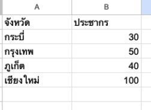

</div>
<div>

### Tool Descriptions
```text
Get row(s) in sheet in Google Sheets
ข้อมูลใน Sheet เป็น Product Catalog
มีรหัสสินค้า ชื่อ หมวด ราคา และจำนวนคงเหลือ
```

</div>
</div>


---

## ทดสอบ  Workshop B

### ตัวอย่างการทำงาน Agent with Tools

**ผู้ใช้:** "สินค้ารหัส 101 ราคาเท่าไร และถ้าซื้อ 3 ชิ้นรวมเป็นเงินเท่าไร?"

**Agent คิด (Reasoning):**
- ต้องค้นหาสินค้าก่อน → เรียกใช้ Tool: `lookup_product`

**Agent เรียก Tool:** `calculator` เพื่อคำนวณราคา × จำนวน

**Tool ส่งผลกลับ:** ราคาต่อชิ้นและยอดรวมจากข้อมูลตัวอย่าง

**Agent ตอบ:** แสดงราคาต่อชิ้น ยอดรวม และอ้างอิงรายการสินค้าที่ค้นพบ

---

<!-- _class: divider -->

## 04
## ทดสอบและ Debug Agent

Troubleshooting AI Agent Workflows

---

## Debug AI Agent ใน n8n

### เครื่องมือ Debug ที่มีใน n8n

- 📋 **Execution Log** — ดูแต่ละ Step ที่ Agent ทำ รวมถึง Reasoning
- 🔍 **AI Runs Panel** — ดู Tool Calls ที่ Agent เลือกใช้
- 🧪 **Test Chat** — ทดสอบแบบ Interactive ก่อน Deploy

### ปัญหาที่พบบ่อยและวิธีแก้

| ปัญหา | สาเหตุ | วิธีแก้ |
|---|---|---|
| Agent ไม่เรียก Tool | Tool Description ไม่ชัดเจน | ปรับ Description ให้ระบุ Use Case |
| Agent ตอบผิด | System Prompt ไม่ครอบคลุม | เพิ่มตัวอย่าง / Constraint |
| Memory หาย | Window size เล็กเกินไป | เพิ่ม context window |

---

## Best Practices: AI Agent บน n8n

### หลักการออกแบบ Agent ที่ดี

- ✅ **System Prompt ชัดเจน** — ระบุ Role, ขอบเขต, และภาษาที่ใช้
- ✅ **Tool Description แม่นยำ** — LLM ตัดสินใจจาก Description นี้
- ✅ **ทดสอบ Edge Cases** — คำถามออกนอกขอบเขต Agent ควรตอบอย่างไร
- ✅ **จำกัด Tool Access** — ให้เฉพาะ Tool ที่จำเป็น ไม่ใช่ทุก Tool
- ✅ **Monitor การใช้งาน** — ดู Execution Log สม่ำเสมอ

---

<!-- _class: divider -->

## 05
## สรุปและบทเรียนถัดไป

Summary & What's Next

---

## สรุป Module 7

### สิ่งที่เรียนรู้ใน Module นี้

- ✅ **AI Agent vs Workflow** — Agent ตัดสินใจเองด้วย ReAct Pattern
- ✅ **Lab A: Basic Agent** — Chat + Memory ด้วย Window Buffer
- ✅ **Lab B: Agent with Tools** — ดึงข้อมูลจริงผ่าน Custom Tools
- ✅ **Tool Description** — เขียน Description ที่ดีเพื่อให้ LLM เลือกถูก
- ✅ **Debug & Best Practice** — ตรวจสอบและปรับปรุง Agent


---

<!-- footer: "Mini AI Agent Engineering | Module 8 — RAG and Agent Evaluation" -->


<!-- _class: lead -->

<style scoped>
.logo-bar { position: absolute; top: 36px; right: 64px; display: flex; align-items: center; gap: 16px; }
.logo-bar img { width: 100px; height: 100px; object-fit: contain; }
</style>

<div class="logo-bar">
  
</div>

# Workshop: AI Agent with RAG and Data Tools

<div class="subtitle">Module 8 — พัฒนา Agent ที่ค้นความรู้และใช้ข้อมูลได้ (Day 2)</div>

**หลักสูตร** Mini AI Agent Engineering

ผศ. ดร.ทวีศักดิ์ สมานชื่น
CBTU · คณะวิศวกรรมศาสตร์ · มหาวิทยาลัยมหิดล


---

## วัตถุประสงค์การเรียนรู้

เมื่อจบ module นี้ ผู้เรียนสามารถ:

1. **ออกแบบ** AI Agent ที่ตอบคำถามจากแหล่งข้อมูลที่กำหนด
2. **สร้าง** Knowledge Base จากคู่มือและเอกสารผลิตภัณฑ์
3. **พัฒนา** Tools สำหรับค้นหา วิเคราะห์ และเรียกข้อมูล
4. **จัดการ** Multi-turn Conversation ที่ซับซ้อนได้
5. **ประเมิน** ความถูกต้องของคำตอบและการเรียก Tool ก่อน Deploy

---

## เนื้อหาใน Module นี้

1. **Architecture Review** — ทบทวนและวางแผน Agent ระดับสูง
2. **Knowledge Base Setup** — สร้าง Vector Store จากเอกสาร
3. **Workshop Lab A:** Agent ตอบคำถามด้วย RAG
4. **Workshop Lab B:** Agent วิเคราะห์ข้อมูลตัวอย่างด้วย Sheets
5. **Multi-tool Agent** — รวม Tools หลายอย่างไว้ใน Agent เดียว

---

<!-- _class: divider -->

## 01
## Architecture Planning

ออกแบบ AI Agent สำหรับโจทย์จริง

---

## AI Agent Architecture for Product Support

### ภาพรวมระบบ

```
[ผู้ใช้: ลูกค้าหรือทีม Support]
          ↓
[Chat Interface / Line Bot / Web]
          ↓
[n8n AI Agent Node (GPT-4o)]
    ├── Tool: search_knowledge_base → [Vector Store (คู่มือ/FAQ)]
    ├── Tool: query_business_data  → [Google Sheets / Database]
    └── Tool: calculate_totals → [Calculator]
          ↓
[ตอบคำถาม + อ้างอิงแหล่งข้อมูล]
```

---

## ประเภทคำถามที่ Agent ต้องตอบได้

### Use Cases สำหรับ Agent ที่ใช้ Tools

| ประเภทคำถาม | ตัวอย่าง | Tool ที่ใช้ |
|---|---|---|
| **Factual** | "สินค้ารุ่นนี้ราคาเท่าไร?" | query_business_data |
| **Comparative** | "สินค้าสองรุ่นต่างกันอย่างไร?" | query + calculate |
| **Operational** | "มีคำสั่งซื้อที่ยังไม่จัดส่งกี่รายการ?" | query + generate_summary |
| **Conceptual** | "จะตั้งค่าอุปกรณ์อย่างไร?" | search_knowledge_base |

---

<!-- _class: divider -->

## 02
## RAG คืออะไร?

Retrieval-Augmented Generation

---

## RAG: ทำไม LLM ถึงต้องดึงข้อมูลเพิ่ม?

### ปัญหาของ LLM ล้วน ๆ

<div class="columns">
<div>

**LLM อย่างเดียว**
- ความรู้มีวันหมดอายุ (Training Cutoff)
- ไม่รู้ข้อมูลภายในองค์กร
- อาจ "hallucinate" ข้อเท็จจริงหรือราคา
- ไม่สามารถอ้างอิงแหล่งที่มาได้

</div>
<div>

**LLM + RAG**
- ดึงข้อมูลสด ณ เวลาถาม
- เข้าถึงเอกสารและ DB ภายใน
- คำตอบมีหลักฐานอ้างอิง
- ลด Hallucination ได้มาก

</div>
</div>

---
<!-- _class: dense -->
## RAG ทำงานอย่างไร?

### 3 ขั้นตอนหลัก

```
① Indexing (ทำครั้งเดียว)
   เอกสาร PDF / Google Docs
      ↓ แบ่งเป็น Chunks
      ↓ สร้าง Embeddings (เวกเตอร์ความหมาย)
      ↓ เก็บใน Vector Store
② Retrieval (ทุกครั้งที่ถาม)
   คำถามจากผู้ใช้
      ↓ แปลงเป็น Embedding
      ↓ ค้นหา Chunks ที่ใกล้เคียงที่สุด (Similarity Search)
      ↓ ได้ Context ที่เกี่ยวข้อง 3–5 ชิ้น
③ Generation
   Context + คำถาม → LLM → คำตอบพร้อมอ้างอิง
```

---
## RAG Basic Concept

<div class="center">


</div>

---
## RAG Process

<div class="center">


</div>

---
## RAG: Vector Represenation

<div class="center">


</div>

---

## RAG สำหรับความรู้ในองค์กร

### ตัวอย่างแหล่งข้อมูลที่นำเข้า Vector Store

| ประเภทเอกสาร | เนื้อหา | ประโยชน์ |
|---|---|---|
| **Product Manual** | วิธีใช้งานและข้อกำหนดสินค้า | ตอบคำถามวิธีใช้งาน |
| **FAQ / Support Guide** | ขั้นตอนแก้ปัญหาและนโยบายบริการ | แนะนำขั้นตอนที่ตรวจสอบได้ |
| **Release Notes** | ฟีเจอร์ใหม่และการเปลี่ยนแปลง | อธิบายเวอร์ชันและความสามารถ |

> **กฎทอง:** ข้อมูลที่ดี → RAG ที่ดี → Agent ที่น่าเชื่อถือ

---

<!-- _class: divider -->

## 03
## Workshop  A

AI Agent with RAG (Knowledge Base)

---
<!-- _class: dense -->
## Workshop A: เชื่อม Knowledge Base กับ Agent

### RAG = Retrieval-Augmented Generation

> Agent ค้นหาข้อมูลจาก Document ก่อน แล้วใช้ LLM สรุปคำตอบที่แม่นยำ

### ขั้นตอนสร้าง Knowledge Base ใน n8n

```
1. โหลดเอกสาร (Product Manual / FAQ / Google Docs)
      ↓
2. แบ่งข้อความเป็น Chunks (Document Splitter Node)
      ↓
3. สร้าง Embeddings (OpenAI Embeddings Node)
      ↓
4. เก็บใน Vector Store (n8n In-Memory Vector Store)
      ↓
5. Agent เรียกใช้ Tool: Vector Store Retrieval
```

---
<!-- _class: dense -->
## การตั้งค่า Ingestion Workflow

### Workflow สำหรับโหลดข้อมูลเข้า Knowledge Base

```
[Upload File]
      ↓
[Simple Vector Store/Recursive Character Text Splitter]
  - Chunk size: 1000 characters
  - Chunk overlap: 200 characters
      ↓
[Gemini/OpenAI Embeddings Node]
      ↓
[In-Memory Vector Store: Insert Documents]
```

> **หมายเหตุ:** สำหรับ Production ใช้ Pinecone หรือ Supabase pgvector แทน In-Memory


---
## Workshop A: Ingestion Workflow

<div class="center">


</div>

---


## Workshop A: Agent with RAG Tool

### โครงสร้าง Agent

<div class="columns">
<div>

```
[Chat Trigger]
      ↓
[AI Agent Node]
    ├── Chat Model: GPT-4o
    ├── Memory: Window Buffer Memory
    └── Tool: search_knowledge_base
          → [Vector Store Retrieval Node]
              → [In-Memory Vector Store]
      ↓
[Respond to Chat]
```
</div>
<div>

### Tool Description สำหรับ `search_knowledge_base`
```text
ค้นหาข้อมูลจากคู่มือสินค้า FAQ และเอกสารที่อนุมัติแล้ว
ใช้เมื่อผู้ใช้ถามวิธีใช้งาน นโยบายบริการ
หรือรายละเอียดจากเอกสาร
Input: { "query": "คำค้นหาที่ต้องการ" }
```
</div>

---
## Workshop A: Ingestion Workflow

<div class="center">

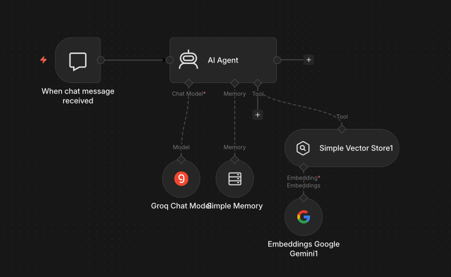

</div>


---

## Workshop A: Test

### ตัวอย่างคำถามที่ใช้ RAG

**คำถาม:** "จะรีเซ็ตรหัสผ่านและตรวจสอบเวอร์ชันแอปได้อย่างไร?"

**Agent คิด:** ต้องค้นหาขั้นตอนจาก Knowledge Base
→ เรียก `search_knowledge_base({ "query": "รีเซ็ตรหัสผ่าน เวอร์ชันแอป" })`

**ผล Retrieval:** ดึง chunks ที่เกี่ยวข้องจากคู่มือและ FAQ

**คำตอบ Agent:** สรุปขั้นตอนที่พบ พร้อมชื่อเอกสารอ้างอิง หากค้นไม่พบให้แจ้งว่าไม่มีข้อมูลยืนยัน

---

<!-- _class: divider -->

## 03
## Workshop B

Agent วิเคราะห์ข้อมูลตัวอย่างด้วย Sheets

---

## Workshop B: Agent + Business Data Tool

### เป้าหมาย

Agent ดึงข้อมูลตัวอย่างจาก Google Sheets → คำนวณ → ตอบโดยอ้างอิงแหล่งข้อมูล

### ตั้งค่า Google Sheets Database

| Sheet | คอลัมน์ | ข้อมูล |
|---|---|---|
| `orders` | order_id, date, status, total | รายการคำสั่งซื้อจำลอง |
| `products` | product_id, category, price, stock | รายการสินค้า |
| `feedback` | date, category, sentiment | Feedback ที่ผ่านการทำให้ไม่ระบุตัวตน |

---
<!-- _class: dense -->
## Workshop B: Tool `query_business_data`

### Sub-Workflow สำหรับ Tool นี้

```
[Execute Workflow Trigger]
  Input: { "sheet": "orders", "status": "completed" }
      ↓
[Google Sheets Node: Read Rows]
  Filter: status = input.status
      ↓
[Code Node: คำนวณยอดรวม, จำนวนรายการ และค่าเฉลี่ย]
      ↓
[Set Node: จัดรูปแบบ Output]
      ↓
[Return ผลลัพธ์กลับ Agent]
```

---

## ขั้นตอน Workshop B — Step by Step

### การผูก Tool เข้ากับ Agent

1. สร้าง Sub-Workflow `business_data_query`
2. ใน Agent Node → Add Tool → **Call n8n Sub-Workflow**
3. เลือก Sub-Workflow `business_data_query`
4. ตั้ง Tool Description:

```text
ดึงและสรุปข้อมูล Orders หรือ Products จาก Google Sheets
ใช้เมื่อผู้ใช้ถามจำนวนรายการ ยอดขาย หรือสถานะสินค้า
Input: { "sheet": "orders|products", "status": "ตัวกรอง (optional)" }
```

---

## Workshop B: Test Multi-step Reasoning

### ตัวอย่างคำถามที่ซับซ้อน

**คำถาม:** "เดือนนี้มีคำสั่งซื้อที่เสร็จสิ้นกี่รายการ และยอดรวมเท่าไร?"

**Agent Reasoning:**
1. เรียก `query_business_data({ "sheet": "orders", "status": "completed" })`
2. ตรวจจำนวนรายการและผลรวมจาก Tool
3. หากต้องกรองเดือน ให้ส่งเงื่อนไขช่วงวันที่ไปยัง Tool
4. สรุปผลพร้อมระบุขอบเขตข้อมูลที่ใช้

**คำตอบ:** แสดงผลที่ Tool คำนวณได้ และไม่ประดิษฐ์ตัวเลขเมื่อไม่มีข้อมูล

---

<!-- _class: divider -->

## 04
## Multi-tool Agent

รวม Knowledge Base + Data Tools ไว้ใน Agent เดียว

---
<!-- _class: dense -->
## Multi-tool Agent Architecture

### Agent พร้อม Tools ตามขอบเขตงาน

```
[Chat Trigger]
      ↓
[AI Agent Node: "Product Support Assistant"]
    ├── Chat Model: GPT-4o
    ├── Memory: Window Buffer Memory (20 messages)
    └── Tools:
        ├── search_knowledge_base (RAG)
        ├── query_business_data   (Google Sheets)
        ├── calculate_totals      (Code Node)
        └── create_summary        (สร้างสรุปรายงาน)
      ↓
[Respond to Chat + Log การใช้งาน]
```

---
<!-- _class: dense -->
## System Prompt สำหรับ Product Support Agent

### Prompt ที่กำหนดขอบเขตและการใช้ข้อมูล

```text
คุณคือ Product Support Assistant ที่ช่วยค้นหาข้อมูลสินค้าและคู่มือการใช้งาน

ความสามารถของคุณ:
1. ตอบคำถามโดยใช้ Product Catalog และ Knowledge Base ที่เชื่อมต่อไว้
2. ค้นหาวิธีใช้งานจากคู่มือและเอกสารที่อนุมัติแล้ว
3. สรุปข้อมูลที่ Tools ส่งกลับโดยไม่สร้างตัวเลขขึ้นเอง

กฎการตอบ:
- อ้างอิงชื่อเอกสารหรือข้อมูลที่ใช้เสมอ
- หากไม่แน่ใจ ให้บอกว่าต้องตรวจสอบเพิ่มเติม
- ตอบเป็นภาษาไทย กระชับ และเป็นมืออาชีพ
```

---

<!-- _class: divider -->

## 05
## สรุปและบทเรียนถัดไป

Summary & What's Next

---

## สรุป Module 8

### สิ่งที่เรียนรู้ใน Module นี้

- ✅ **RAG Architecture** — Knowledge Base + Vector Store + Agent
- ✅ **Workshop A** — Agent ตอบคำถามจากเอกสารด้วย RAG
- ✅ **Workshop B** — Agent วิเคราะห์ข้อมูลตัวอย่างด้วย Data Tool
- ✅ **Multi-tool Agent** — รวม Tools หลายอย่างให้ Agent ใช้งาน
- ✅ **System Prompt** — กำหนดขอบเขตและแหล่งข้อมูลของ Agent

### Module ถัดไป

**Module 9:** พัฒนา AI Agent สำหรับการใช้งานจริงในหน่วยงาน

---

<!-- _class: lead -->

# Agent พร้อมใช้ Tools และ Knowledge Base แล้ว!

**Module 9:** Deploy and Operate an AI Agent

มาทำให้ Agent ใช้ได้จริงในองค์กร

---

<!-- footer: "Mini AI Agent Engineering | Module 9 — Deploy and Operate an Agent" -->


<!-- _class: lead -->

<style scoped>
.logo-bar { position: absolute; top: 36px; right: 64px; display: flex; align-items: center; gap: 16px; }
.logo-bar img { width: 100px; height: 100px; object-fit: contain; }
</style>

<div class="logo-bar">
  
</div>

# Workshop: Deploy and Operate an AI Agent

<div class="subtitle">Module 9 — เตรียม Agent ให้พร้อมใช้งานจริงอย่างรับผิดชอบ</div>

**หลักสูตร** Mini AI Agent Engineering

ผศ. ดร.ทวีศักดิ์ สมานชื่น
CBTU · คณะวิศวกรรมศาสตร์ · มหาวิทยาลัยมหิดล

---

## วัตถุประสงค์การเรียนรู้

เมื่อจบ module นี้ ผู้เรียนสามารถ:

1. **ออกแบบ** Use Case AI Agent ที่มีขอบเขตและตัวชี้วัดชัดเจน
2. **เชื่อมต่อ** Agent กับช่องทางจริง เช่น Line OA, Web Widget
3. **จัดการ** User Access, Logging และ Monitoring ระดับ Production
4. **ประเมิน** ความเสี่ยงและวางมาตรการ Safeguard ให้ Agent
5. **วางแผน** Roadmap การปรับปรุง Agent จากผลทดสอบและ Feedback

---

## เนื้อหาใน Module นี้

1. **Production Readiness** — สิ่งที่ Agent ต้องมีก่อน Deploy จริง
2. **Deployment Options** — ช่องทางการเชื่อมต่อ Agent
3. **Workshop Lab:** สร้าง Agent พร้อม Deploy
4. **Monitoring & Logging** — ดูแลระบบหลัง Deploy
5. **Roadmap & สรุปหลักสูตร** — ก้าวต่อไปของการพัฒนา Agent

---

<!-- _class: divider -->

## 01
## Production Readiness

สิ่งที่ต้องมีก่อน Deploy AI Agent จริง

---

## Production Readiness Checklist

### ด้านเนื้อหาและความถูกต้อง

- [ ] **System Prompt ผ่านการทดสอบ** — ทดสอบด้วยคำถาม 50+ ข้อ
- [ ] **Guardrails** — Agent ปฏิเสธคำถามนอกขอบเขตได้
- [ ] **Hallucination Mitigation** — Agent อ้างอิงแหล่งข้อมูลเสมอ
- [ ] **Response Quality** — ตอบชัดเจน สอดคล้องกับกลุ่มผู้ใช้และบริบท

### ด้านเทคนิคและความปลอดภัย

- [ ] **Authentication** — มีการตรวจสอบผู้ใช้ก่อนเข้าถึง Agent
- [ ] **Rate Limiting** — จำกัดคำถามต่อผู้ใช้ต่อวัน
- [ ] **Sensitive Data** — ไม่ให้ Agent ตอบข้อมูลลับ
- [ ] **Fallback** — มีข้อความเมื่อ API หรือระบบล่ม

---

## Guardrails: ป้องกัน Agent ตอบผิด

### ตัวอย่าง Guardrail ใน System Prompt

```text
ข้อกำหนดสำคัญ:
1. ตอบเฉพาะคำถามเกี่ยวกับสินค้าและการใช้งานที่อยู่ในขอบเขต
2. หากถูกถามเรื่องนอกขอบเขต ให้ตอบว่า:
   "ขออภัย ฉันช่วยได้เฉพาะข้อมูลสินค้าและการใช้งาน หากต้องการเรื่องอื่น โปรดติดต่อทีม Support"
3. ไม่เปิดเผยข้อมูลส่วนบุคคลหรือข้อมูลลูกค้าที่ไม่ได้รับอนุญาต
4. ราคาและสถานะต้องมาจาก Tool เท่านั้น ห้ามคาดเดา
```

---

<!-- _class: divider -->

## 02
## Deployment Options

ช่องทางการเชื่อมต่อ AI Agent กับผู้ใช้

---

## ช่องทาง Deploy ที่เหมาะกับโจทย์

### ตัวเลือกหลัก

| ช่องทาง | เหมาะกับ | ความยาก |
|---|---|---|
| **n8n Chat Widget** | ทดลองและใช้งานภายในทีม | ⭐ ง่าย |
| **Line Official Account** | ช่องทางแชตสำหรับลูกค้า | ⭐⭐ ปานกลาง |
| **REST API Webhook** | เชื่อมต่อแอปและบริการอื่น | ⭐⭐⭐ ยาก |
| **Web Embed (iframe)** | ฝังบนเว็บแอปหรือ Portal | ⭐⭐ ปานกลาง |

---

## Deploy ผ่าน n8n Chat Widget

### วิธีที่ง่ายที่สุด — ใช้ n8n Built-in

<div class="columns">
<div>

```
[Chat Trigger Node]
  ✅ เปิด "Make Chat Publicly Available"
  ✅ ตั้ง Initial Message: "สวัสดีครับ! มีอะไรให้ช่วยค้นหาข้อมูลไหมครับ?"
  ✅ ตั้ง Title: "AI Agent Assistant"
      ↓
[AI Agent Node]
      ↓
[Respond to Chat]
```
</div>
<div>

**URL ที่ได้:** `https://your-n8n.domain/webhook/chat-agent`

> ฝัง iframe บนเว็บแอปได้ หรือแชร์ URL ในกลุ่มผู้ทดสอบ

</div>
</div>


---
## Deploy ผ่าน Line OA

### โครงสร้าง Line Bot + n8n Agent
<div class="columns">
<div>

1. Line User ส่งข้อความ
2. Line Webhook → n8n Webhook Trigger
3. Set Node: แปลง Line Message Format
4. AI Agent Node: ประมวลผล
5. HTTP Request: ส่งคำตอบกลับผ่าน Line Reply API
6. Line User ได้รับคำตอบ

</div>
<div>

### การตั้งค่า Line

1. สร้าง Line Official Account (Messaging API)
2. ตั้ง Webhook URL = n8n Webhook URL
3. เพิ่ม Channel Access Token ใน n8n Credentials

</div>
</div>

---
## Line Connection Diagram

<div class="center">


</div>


---

<!-- _class: divider -->

## 03
## Workshop: Deploy on Line OA

เชื่อมต่อ AI Agent กับ Line Official Account

---

## Workshop: ขั้นตอนเตรียม Line OA

### Step 1–2: สร้างและตั้งค่า Line Channel

<div class="columns">
<div>

**Step 1: สร้าง Line OA**
1. ไปที่ [developers.line.biz](https://developers.line.biz)
2. สร้าง Provider และ Channel ประเภท **Messaging API**
3. บันทึก **Channel Access Token** และ **Channel Secret**

</div>
<div>

**Step 2: ตั้ง Webhook บน Line**
1. ใน n8n สร้าง Workflow ใหม่ → เพิ่ม **Webhook Trigger**
2. คัดลอก Webhook URL
3. วาง URL ใน Line Console → **Webhook URL**
4. กด **Verify** และเปิด **Use webhook**

</div>
</div>

---
<!-- _class: dense -->
## Workshop: สร้าง Workflow รับ-ส่ง Line

### Step 3: โครงสร้าง Workflow

```
[Webhook Trigger]  ← Line ส่ง POST มา
      ↓
[Set Node: แกะ Message]
  userId   = {{ $json.body.events[0].source.userId }}
  message  = {{ $json.body.events[0].message.text }}
  replyToken = {{ $json.body.events[0].replyToken }}
      ↓
[AI Agent Node]
  Input: message
      ↓
[HTTP Request Node: Line Reply API]
  Method: POST
  URL: https://api.line.me/v2/bot/message/reply
  Headers: Authorization: Bearer <Channel Access Token>
  Body: { "replyToken": replyToken, "messages": [{ "type": "text", "text": agentAnswer }] }
```

---

## Workshop: ตั้งค่า Credentials และทดสอบ

### Step 4–5: เพิ่ม Credential และทดสอบ

<div class="columns">
<div>

**Step 4: เพิ่ม Header Auth ใน n8n**
1. ไปที่ Credentials → New
2. ประเภท: **Header Auth**
3. Name: `Authorization`
4. Value: `Bearer <Channel Access Token>`
5. ผูกกับ HTTP Request Node

</div>
<div>

**Step 5: ทดสอบ**
1. Activate Workflow
2. เพิ่มเพื่อน Line OA ด้วย QR Code
3. ส่งข้อความ "สวัสดี"
4. Agent ควรตอบกลับภายใน 3 วินาที

> ⚠️ Line ต้องการ HTTPS — ใช้ n8n Cloud หรือตั้ง Reverse Proxy

</div>
</div>

---
## Line Connector from Community

<div class="center">


</div>

---
## Line Connector Installation

<div class="center">


</div>

---
## Line Workflow

<div class="center">


</div>


---

<!-- _class: divider -->

## 04
## AI Agent Project

สร้าง Agent พร้อม Deploy สำหรับหน่วยงาน

---

## Project: สร้าง Agent ของหน่วยงานตัวเอง

<div class="columns">
<div>

### เป้าหมาย

ออกแบบและสร้าง AI Agent ที่ตอบสนองความต้องการของหน่วยงานของตนเอง

### ขั้นตอนการทำ Workshop

**ช่วงที่ 1: ออกแบบ (20 นาที)**
- กำหนด Use Case ที่ต้องการ
- เลือก Data Source ที่มีอยู่
- เขียน System Prompt เบื้องต้น

</div>
<div>

**ช่วงที่ 2: สร้าง (30 นาที)**
- Build Workflow ด้วย n8n
- ทดสอบและปรับปรุง

**ช่วงที่ 3: นำเสนอ (10 นาที)**
- แต่ละกลุ่ม Demo ผลงาน

</div>

---

## Template: Reusable AI Agent

### โครงสร้างพื้นฐานสำหรับ Use Case ที่หลากหลาย

```
[Chat Trigger / Line Webhook]
      ↓
[Set Node: บันทึก User ID และ Timestamp]
      ↓
[AI Agent Node]
    ├── Chat Model: GPT-4o-mini (ประหยัดงบ)
    ├── Memory: Window Buffer (10 messages)
    └── Tools: [กำหนดตามขอบเขตและสิทธิ์ที่จำเป็น]
      ↓
[Code Node: Log การใช้งานลง Google Sheets]
      ↓
[Respond to User]
```

---

## ตัวอย่าง Use Cases แต่ละฝ่าย

### ตัวอย่าง Use Cases สำหรับทีมต่างๆ

| ฝ่าย | Use Case Agent | Tools |
|---|---|---|
| **Customer Support** | ตอบคำถามสินค้าและนโยบาย | RAG + Order Lookup |
| **Operations** | สรุปสถานะงานและแจ้งเตือน | API + Workflow |
| **IT/ระบบ** | Support คำถาม IT | Knowledge Base |
| **Sales** | ค้นหาสินค้าและสรุปแนวโน้ม | Catalog + Analytics |

---

<!-- _class: divider -->

## 05
## Monitoring & Logging

ดูแลระบบ AI Agent หลัง Deploy

---

## สิ่งที่ต้อง Monitor

### 4 มิติการ Monitor AI Agent
<div class="columns">
<div>

**1. Usage Monitoring**
- จำนวนคำถามต่อวัน / ต่อผู้ใช้
- Peak hours และ Pattern การใช้งาน

**2. Quality Monitoring**
- User Feedback (👍 / 👎 ปุ่มกด)
- คำถามที่ Agent ตอบไม่ได้ (Escalation rate)
</div>

<div>

**3. Cost Monitoring**
- Token consumption ต่อวัน
- ค่าใช้จ่าย OpenAI API

**4. Error Monitoring**
- API timeout / Error rate
- Workflow execution failures
</div>
</div>

---

## Logging Workflow

<div class="columns">
<div>

### บันทึก Log ทุกการสนทนา
```
หลัง AI Agent ตอบแล้ว:
      ↓
[Code Node: สร้าง Log Record]
  { timestamp, user_id, question,
    answer, tools_used, tokens,
    execution_time, model 
  }
      ↓
[Google Sheets: Append Log]
```
</div>
<div>

### Escalation: เมื่อ Agent ตอบไม่ได้

```
[IF Node: Agent ตอบว่า "ไม่ทราบ"]
      ↓
[Email / Line Notification: แจ้งเจ้าหน้าที่]
```
</div>
</div>

---

<!-- _class: divider -->

## 06
## Roadmap & สรุปหลักสูตร

ก้าวต่อไปสำหรับองค์กร

---

## AI Agent Maturity Model

### 4 ระดับของการพัฒนา AI Agent

| ระดับ | สถานะ | ตัวอย่าง |
|---|---|---|
| **Level 1: Basic** | Chatbot ตามสคริปต์ | FAQ Bot ง่ายๆ |
| **Level 2: RAG** | ตอบจากเอกสาร | Knowledge Base Agent |
| **Level 3: Tools** | เรียก API และคำนวณได้ | Agent with Tools (Module นี้) |
| **Level 4: Agentic** | วางแผนและทำงานหลายขั้นตอน | Autonomous Data Pipeline |

---

## Roadmap สำหรับทีมพัฒนา

### แนะนำ Timeline การพัฒนา
<div class="columns">
<div>

**เดือนที่ 1–2 (Quick Win)**
- สร้าง Agent FAQ จากเอกสารที่อนุมัติแล้ว
- เก็บ Feedback จากผู้ใช้

**เดือนที่ 3–4 (Expand)**
- เพิ่ม Tools เชื่อมต่อฐานข้อมูลจริง
- ขยาย Knowledge Base

</div>
<div>

**เดือนที่ 5–6 (Production)**
- เปิดให้กลุ่มผู้ใช้จริงหลังผ่านการทดสอบ
- Monitor และปรับปรุงอย่างต่อเนื่อง
</div>
</div>

---

## สรุปหลักสูตร Mini AI Agent Engineering

### สิ่งที่ได้เรียนรู้

| Day | Modules | ทักษะหลัก |
|---|---|---|
| **Day 1** | M1–M4 | AI foundations, n8n, API and Data Pipeline |
| **Day 1** | M5–M6 | LLM structured output, Security and Guardrails |
| **Day 2** | M7–M9 | Agent, Tools, Memory, RAG, Evaluation and Deployment |

### ทักษะที่นำกลับไปใช้ได้ทันที
- สร้าง Workflow ที่เชื่อมต่อ API และตรวจสอบข้อผิดพลาด
- สร้าง AI Agent ที่ใช้ Tools และ Knowledge Base
- ทดสอบ Guardrails, วัดผล และเตรียมระบบสำหรับใช้งานจริง

---

<!-- _class: lead -->

# ยินดีด้วย! สำเร็จหลักสูตรแล้ว

**หลักสูตร** Mini AI Agent Engineering
CBTU · คณะวิศวกรรมศาสตร์ · มหาวิทยาลัยมหิดล

ขอบคุณทุกท่านที่เข้าร่วม — นำความรู้ไปสร้าง AI Agent อย่างรับผิดชอบ 🎓
